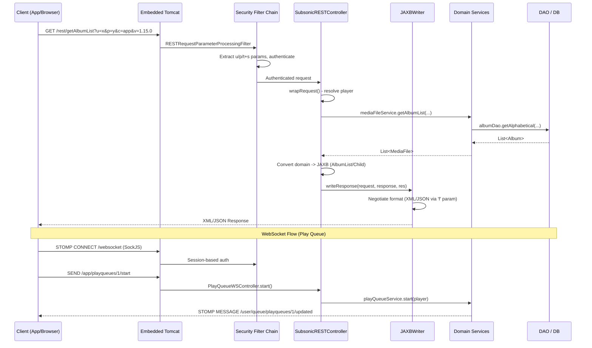

# API & Service Communication Contracts

## 1. Service Catalog

| Module | Artifact | Category | Framework | Default Port | Packaging |
|--------|----------|----------|-----------|-------------|-----------|
| `airsonic-main` | `org.airsonic.player:airsonic-main` | Core application (monolith) | Spring Boot 3.3.7, Spring MVC, Spring WebSocket, Apache CXF 4.0.5 | 4040 | WAR (executable) |
| `subsonic-rest-api` | `org.airsonic.player:subsonic-rest-api` | API contract library (JAXB-generated DTOs) | JAXB (Jakarta XML Binding), XSD code generation | N/A (library) | JAR |
| `airsonic-sonos-api` | `org.airsonic.player:airsonic-sonos-api` | Sonos SOAP contract library (CXF-generated stubs) | Apache CXF wsdl2java, JAX-WS | N/A (library) | JAR |

**Architecture Note:** This is a monolithic application. All three modules are compiled and packaged into a single deployable unit (`airsonic-main`). The `subsonic-rest-api` and `airsonic-sonos-api` modules are build-time code-generation libraries that produce JAXB/JAX-WS stubs consumed directly by `airsonic-main`.

---

## 2. API Endpoints Inventory

### 2.1 Subsonic REST API (`/rest/*`)

The primary programmatic API implementing the [Subsonic API specification](http://www.subsonic.org/pages/api.jsp) v1.15.0. Served by `SubsonicRESTController` under `@RequestMapping("/rest")` accepting both GET and POST.

**Authentication:** Custom `RESTRequestParameterProcessingFilter` processes credentials from query parameters (`u`, `p`/`t`+`s`, `c`, `v`). Supports plaintext, hex-encoded, and token+salt authentication.

**Response Format:** XML (default) or JSON, negotiated via `f` parameter. Responses are serialized through `JAXBWriter` using the JAXB-generated classes from `subsonic-rest-api` module.

| Endpoint | Method | Category | Description |
|----------|--------|----------|-------------|
| `/rest/ping` | GET/POST | System | Connection test |
| `/rest/getLicense` | GET/POST | System | License status (always valid) |
| `/rest/getMusicFolders` | GET/POST | Browsing | List music folders |
| `/rest/getIndexes` | GET/POST | Browsing | Artist index with last-modified support |
| `/rest/getGenres` | GET/POST | Browsing | List all genres |
| `/rest/getArtists` | GET/POST | Browsing | ID3 artist index |
| `/rest/getArtist` | GET/POST | Browsing | Artist with albums (ID3) |
| `/rest/getAlbum` | GET/POST | Browsing | Album with songs (ID3) |
| `/rest/getSong` | GET/POST | Browsing | Single song metadata |
| `/rest/getMusicDirectory` | GET/POST | Browsing | Directory listing |
| `/rest/getVideos` | GET/POST | Browsing | List video files |
| `/rest/getArtistInfo` | GET/POST | Browsing | Artist biography, images, similar |
| `/rest/getArtistInfo2` | GET/POST | Browsing | Artist info (ID3 variant) |
| `/rest/getAlbumInfo` | GET/POST | Browsing | Album metadata from Last.fm |
| `/rest/getAlbumInfo2` | GET/POST | Browsing | Album info (ID3 variant) |
| `/rest/getSimilarSongs` | GET/POST | Browsing | Similar songs |
| `/rest/getSimilarSongs2` | GET/POST | Browsing | Similar songs (ID3 variant) |
| `/rest/getTopSongs` | GET/POST | Browsing | Top songs by artist |
| `/rest/getAlbumList` | GET/POST | Lists | Album list (various sort types) |
| `/rest/getAlbumList2` | GET/POST | Lists | Album list (ID3 variant) |
| `/rest/getRandomSongs` | GET/POST | Lists | Random songs |
| `/rest/getSongsByGenre` | GET/POST | Lists | Songs filtered by genre |
| `/rest/getNowPlaying` | GET/POST | Lists | Currently playing tracks |
| `/rest/getStarred` | GET/POST | Lists | Starred items |
| `/rest/getStarred2` | GET/POST | Lists | Starred items (ID3 variant) |
| `/rest/search` | GET/POST | Search | Legacy search |
| `/rest/search2` | GET/POST | Search | Search (artist/album/song) |
| `/rest/search3` | GET/POST | Search | Search (ID3 variant) |
| `/rest/getPlaylists` | GET/POST | Playlists | List playlists |
| `/rest/getPlaylist` | GET/POST | Playlists | Playlist with entries |
| `/rest/createPlaylist` | GET/POST | Playlists | Create/update playlist |
| `/rest/updatePlaylist` | GET/POST | Playlists | Update playlist metadata/songs |
| `/rest/deletePlaylist` | GET/POST | Playlists | Delete playlist |
| `/rest/star` | GET/POST | Media annotation | Star items |
| `/rest/unstar` | GET/POST | Media annotation | Unstar items |
| `/rest/setRating` | GET/POST | Media annotation | Set media rating (1-5) |
| `/rest/scrobble` | GET/POST | Media annotation | Scrobble (record play) |
| `/rest/getShares` | GET/POST | Sharing | List shares |
| `/rest/createShare` | GET/POST | Sharing | Create share link |
| `/rest/updateShare` | GET/POST | Sharing | Update share metadata |
| `/rest/deleteShare` | GET/POST | Sharing | Delete share |
| `/rest/getPodcasts` | GET/POST | Podcast | List podcast channels/episodes |
| `/rest/getNewestPodcasts` | GET/POST | Podcast | Newest podcast episodes |
| `/rest/refreshPodcasts` | GET/POST | Podcast | Refresh all channels |
| `/rest/createPodcastChannel` | GET/POST | Podcast | Subscribe to channel |
| `/rest/deletePodcastChannel` | GET/POST | Podcast | Unsubscribe channel |
| `/rest/deletePodcastEpisode` | GET/POST | Podcast | Delete episode |
| `/rest/downloadPodcastEpisode` | GET/POST | Podcast | Download episode |
| `/rest/exportPodcasts/opml` | GET/POST | Podcast | Export OPML |
| `/rest/getInternetRadioStations` | GET/POST | Internet Radio | List radio stations |
| `/rest/getBookmarks` | GET/POST | Bookmarks | List playback bookmarks |
| `/rest/createBookmark` | GET/POST | Bookmarks | Create/update bookmark |
| `/rest/deleteBookmark` | GET/POST | Bookmarks | Delete bookmark |
| `/rest/getPlayQueue` | GET/POST | Play Queue | Get saved play queue |
| `/rest/savePlayQueue` | GET/POST | Play Queue | Save play queue state |
| `/rest/jukeboxControl` | GET/POST | Jukebox | Control server-side playback |
| `/rest/getUser` | GET/POST | User management | Get user details |
| `/rest/getUsers` | GET/POST | User management | List all users |
| `/rest/createUser` | GET/POST | User management | Create user |
| `/rest/updateUser` | GET/POST | User management | Update user |
| `/rest/deleteUser` | GET/POST | User management | Delete user |
| `/rest/changePassword` | GET/POST | User management | Change password |
| `/rest/getLyrics` | GET/POST | Media retrieval | Get lyrics |
| `/rest/getCoverArt` | GET/POST | Media retrieval | Get cover art image |
| `/rest/getAvatar` | GET/POST | Media retrieval | Get user avatar |
| `/rest/stream` | GET/POST | Media streaming | Stream audio |
| `/rest/download` | GET/POST | Media streaming | Download file |
| `/rest/hls` | GET/POST | Media streaming | HLS streaming |
| `/rest/getVideoInfo` | GET/POST | Video | Video metadata |
| `/rest/getCaptions` | GET/POST | Video | Captions (not implemented) |
| `/rest/getChatMessages` | GET/POST | Chat | Get chat (no longer supported) |
| `/rest/addChatMessage` | GET/POST | Chat | Add chat (no longer supported) |
| `/rest/startScan` | GET/POST | Admin | Trigger media library scan |
| `/rest/getScanStatus` | GET/POST | Admin | Get scan progress |

### 2.2 Media Streaming Endpoints

| Controller | Path(s) | Method | Description |
|------------|---------|--------|-------------|
| `StreamController` | `/stream/**`, `/ext/stream/**` | GET | Audio stream with transcoding, range requests, ShoutCast |
| `HLSController` | `/hls/hls.m3u8`, `/ext/hls/hls.m3u8` | GET | HLS master playlist generation |
| `HLSController` | `/hls/segment/**`, `/ext/hls/segment/**` | GET | HLS segment delivery |
| `DownloadController` | `/download` | GET | File/zip download |
| `CoverArtController` | `/coverArt`, `/ext/coverArt` | GET | Cover art image serving (supports caching via Last-Modified) |
| `CaptionsController` | `/captions` | GET | Video captions/subtitles |

**Note:** Paths prefixed with `/ext/` are accessible via JWT token authentication (stateless), used for external/shared players.

### 2.3 Web UI Controllers (MVC - View-returning)

These controllers serve the JSP-based web UI. They return `ModelAndView` or view names.

| Controller | Base Path | Role |
|------------|-----------|------|
| `HomeController` | `/home` | Dashboard / home page |
| `MainController` | `/main` | Main content frame |
| `LeftController` | `/left` | Left navigation (artist index) |
| `RightController` | `/right` | Right content panel |
| `TopController` | `/top` | Top navigation frame |
| `IndexController` | `/index` | Frame-set root |
| `PlayQueueController` | `/playQueue` | Play queue panel |
| `SearchController` | `/search` | Search UI |
| `PlaylistController` | `/playlist` | Single playlist view |
| `PlaylistsController` | `/playlists` | Playlists list |
| `StarredController` | `/starred` | Starred items |
| `PodcastChannelController` | `/podcastChannel` | Podcast channel view |
| `PodcastChannelsController` | `/podcastChannels` | Podcast listing |
| `PodcastController` | `/podcast` | Podcast episode view |
| `BookmarksController` | `/bookmarks` | Bookmarks UI |
| `VideoPlayerController` | `/videoPlayer` | Video player |
| `NowPlayingController` | `/nowPlaying` | Now playing info |
| `MoreController` | `/more` | More options page |
| `LoginController` | `/login` | Login page |
| `RecoverController` | `/recover` | Password recovery |
| `GettingStartedController` | `/gettingStarted` | Setup wizard |
| `HelpController` | `/help` | System info/help |

### 2.4 Settings Controllers (Admin MVC)

| Controller | Base Path | Role |
|------------|-----------|------|
| `SettingsController` | `/settings` | Settings hub |
| `GeneralSettingsController` | `/generalSettings` | General settings |
| `AdvancedSettingsController` | `/advancedSettings` | Advanced options |
| `PersonalSettingsController` | `/personalSettings` | Per-user preferences |
| `PlayerSettingsController` | `/playerSettings` | Player configuration |
| `MusicFolderSettingsController` | `/musicFolderSettings` | Media folder management |
| `TranscodingSettingsController` | `/transcodingSettings` | Transcoding rules |
| `InternetRadioSettingsController` | `/internetRadioSettings` | Internet radio |
| `PodcastSettingsController` | `/podcastSettings` | Podcast settings |
| `ShareSettingsController` | `/shareSettings` | Sharing settings |
| `UserSettingsController` | `/userSettings` | User admin |
| `DatabaseSettingsController` | `/databaseSettings` | Database backup/import |
| `DLNASettingsController` | `/dlnaSettings` | DLNA/UPnP settings |
| `SonosSettingsController` | `/sonosSettings` | Sonos service settings |
| `CredentialsManagementController` | `/credentialsSettings` | Credential management |

### 2.5 Sonos SOAP API (`/ws/Sonos`)

Published via Apache CXF as a JAX-WS SOAP endpoint. The `SonosService` class implements the `SonosSoap` interface (generated from `sonos-8.4_9.2.wsdl`).

| Operation Category | Key Operations |
|-------------------|---------------|
| Browse | `getMetadata`, `getExtendedMetadata`, `getLastUpdate` |
| Search | `search` |
| Playback | `getMediaMetadata`, `getMediaURI` |
| Favorites | `setRating`, `getRatings` |
| Account linking | `getAppLink`, `getDeviceAuthToken`, `refreshAuthToken` |

**Authentication:** CXF interceptor chain (`SonosLinkSecurityInterceptor`) validates JWT tokens specific to Sonos device linking.

### 2.6 Sonos Link Controller

| Controller | Path | Method | Description |
|------------|------|--------|-------------|
| `SonosLinkController` | `/sonoslink` | GET | Show Sonos link login form |
| `SonosLinkController` | `/sonoslink` | POST | Process Sonos device linking |

### 2.7 JSON REST Endpoints (Non-Subsonic)

| Controller | Path | Method | Description |
|------------|------|--------|-------------|
| `StatisticsController` | `/statistics/users` | GET | User data transfer statistics (JSON) |
| `StatisticsController` | `/statistics/transfers` | GET | Active transfer statuses (JSON) |

### 2.8 Utility Endpoints

| Controller | Path | Method | Description |
|------------|------|--------|-------------|
| `M3UController` | `/play.m3u` | GET | M3U playlist generation |
| `ExportPlayListController` | `/exportPlaylist` | GET | Export playlist file |
| `ImportPlaylistController` | `/importPlaylist` | POST | Import playlist file |
| `AvatarController` | `/avatar` | GET | Serve user avatars |
| `AvatarUploadController` | `/avatarUpload` | POST | Upload custom avatar |
| `UploadController` | `/upload` | POST | Media file upload |
| `ProxyController` | `/proxy` | GET | Proxy external requests |
| `AllmusicController` | `/allmusic` | GET | AllMusic bio fetcher |
| `ExternalPlayerController` | `/ext/share/**` | GET | External shared player |
| `SetRatingController` | `/setRating` | GET | Set media rating |
| `SetMusicFileInfoController` | `/setMusicFileInfo` | POST | Update media metadata |
| `EditTagsController` | `/editTags` | GET | Tag editing UI |
| `ShareManagementController` | `/createShare`, `/shareSettings/delete` | GET/POST | Share lifecycle |
| `RandomPlayQueueController` | `/randomPlayQueue` | GET | Random play queue generation |

---

## 3. Management & Observability Endpoints

Spring Boot Actuator is enabled (`spring-boot-starter-actuator`).

**Configuration** (`application.properties`):
```properties
management.endpoints.web.exposure.include=metrics,health,caches,customscheduledtasks,pathwatcher
management.endpoint.health.show-details=when-authorized
management.endpoint.health.show-components=when-authorized
management.health.ldap.enabled=false
```

| Endpoint | Path | Type | Description |
|----------|------|------|-------------|
| Health | `/actuator/health` | Built-in | Application health (details visible when authorized) |
| Metrics | `/actuator/metrics` | Built-in | Micrometer metrics |
| Caches | `/actuator/caches` | Built-in | Cache statistics |
| Custom Scheduled Tasks | `/actuator/customscheduledtasks` | Custom (`@Endpoint`) | Lists all dynamically scheduled tasks with run metadata |
| Path Watcher | `/actuator/pathwatcher` | Custom (`@Endpoint`) | File system watch keys and paths being monitored |

### Custom Actuator Endpoints

**`CustomScheduledTasksEndpoint`** (id: `customscheduledtasks`):
- Location: `TaskSchedulingService.CustomScheduledTasksEndpoint`
- Returns: Map of task name to metadata (created time, scheduler class, run history)
- Provides: `RunMetadata` with `firstRun`, `lastRun`, `nextRun`, and type (`FIXED_RATE`, `FIXED_DELAY`, `RUN_ONCE`)

**`PathWatcherEndpoint`** (id: `pathwatcher`):
- Location: `PathWatcherService.PathWatcherEndpoint`
- Returns: Map of watch key names to watched filesystem paths

---

## 4. Communication Patterns

### 4.1 Synchronous REST (HTTP)

The primary communication pattern. All API and UI controllers handle requests synchronously on servlet threads.

```
Client (Browser/App) --HTTP--> Embedded Tomcat --> Spring DispatcherServlet --> Controller --> Service --> DAO
```

### 4.2 WebSocket / STOMP (Real-time Push)

**Configuration** (`WebsocketConfiguration`):
- STOMP endpoint: `/websocket` (SockJS fallback enabled)
- Application destination prefix: `/app`
- Broker prefixes: `/topic` (broadcast), `/queue` (user-specific)
- Heartbeat: 20s interval both directions
- Publish order: serial (preservePublishOrder = true)

**WebSocket Controllers** (`@MessageMapping` over STOMP):

| Controller | Destination Prefix | Key Operations |
|------------|-------------------|----------------|
| `PlayQueueWSController` | `/app/playqueues/{playerId}` | get, start, stop, skip, play/*, add, clear, shuffle, remove, rearrange, sort, jukebox/* |
| `PlaylistWSController` | `/app/playlists` | readable, writable, create/*, delete, update, files/* |
| `BookmarksWSController` | `/app/bookmarks` | list, set, delete, get |
| `PodcastWSController` | `/app/podcasts` | all, channel, create, delete, refresh, episodes/newest, search |
| `NowPlayingWSController` | `/app/nowPlaying` | current (subscribe), recent (subscribe) |
| `CoverArtWSController` | `/app/coverart` | search, set |
| `ArtistWSController` | `/app/artist` | info |
| `MediaFileWSController` | `/app/mediafile` | directory/get |
| `LyricsWSController` | `/app/lyrics` | get |
| `StarWSController` | `/app/rate/mediafile` | star, unstar |
| `TagWSController` | `/app/tags` | edit |
| `UserSettingsWSController` | `/app/settings` | sidebar, viewAsList |

**Server-Initiated Push Topics** (via `SimpMessagingTemplate`):

| Topic/Queue | Source Service | Payload |
|-------------|---------------|---------|
| `/topic/scanStatus` | `MediaScannerService` | Scan progress status |
| `/topic/backupStatus` | `DatabaseService` | Backup progress messages |
| `/topic/exportStatus` | `DatabaseService` | Export progress messages |
| `/topic/importStatus` | `DatabaseService` | Import progress messages |
| `/topic/players/deleted` | `PlayerService` | Deleted player ID |
| `/queue/players/updated` | `PlayerService` | Updated player info (user-targeted) |
| `/queue/bookmarks/added` | `BookmarkService` | Added bookmark media file ID (user-targeted) |
| `/queue/bookmarks/deleted` | `BookmarkService` | Deleted bookmark media file ID (user-targeted) |
| `/queue/uploads/status` | `UploadController` | Upload progress (user-targeted) |

### 4.3 SOAP (Sonos Integration)

Apache CXF publishes the `SonosService` as a JAX-WS SOAP endpoint at `/ws/Sonos`. Communication is synchronous request-response over HTTP/SOAP 1.1.

```
Sonos Device --SOAP/HTTP--> CXF Servlet --> SonosLinkSecurityInterceptor --> SonosService --> SonosHelper --> Domain Services
```

### 4.4 Outbound HTTP (External Service Calls)

| Service | Target | Client | Purpose |
|---------|--------|--------|---------|
| `PodcastService` | RSS feed URLs | Apache HttpClient 4.x | Fetch/refresh podcast feeds, download episodes |
| `PodcastIndexService` | podcastindex.org API | Apache HttpClient 4.x | Search podcast directory |
| `LastFMScrobbler` | last.fm API | Apache HttpClient 4.x | Scrobble plays |
| `ListenBrainzScrobbler` | ListenBrainz API | Apache HttpClient 4.x | Scrobble plays |
| `LastFmService` | last.fm API | de.u_mass.lastfm library | Artist/album info, similar artists |
| `SonosServiceRegistration` | Sonos cloud API | HTTP | Register/deregister music service |
| `VersionService` | GitHub releases | HTTP | Check for updates |

### 4.5 UPnP/DLNA (Network Discovery & Streaming)

The `UPnPService` exposes a DLNA media server using the Cling UPnP library. Content is served through `DispatchingContentDirectory` which delegates to processors (Album, Artist, Genre, Folder, Playlist, RecentAlbum).

### 4.6 Task Scheduling (Internal Async)

`TaskSchedulingService` provides a programmatic scheduling abstraction over Spring's `ScheduledTaskRegistrar`:
- Fixed-delay tasks (e.g., podcast refresh)
- Fixed-rate tasks (e.g., media scan intervals)  
- One-shot tasks (e.g., delayed cleanup)

---

## 5. DTOs and Contracts

### 5.1 Subsonic REST API DTOs (XSD-generated JAXB)

Generated from `subsonic-rest-api.xsd` (namespace: `http://subsonic.org/restapi`, version 1.15.0) into package `org.subsonic.restapi`.

| Class | Role |
|-------|------|
| `Response` | Root response wrapper (status + version + payload choice) |
| `ResponseStatus` | Enum: `ok`, `failed` |
| `Error` | Error response payload (code + message) |
| `MusicFolders` / `MusicFolder` | Music folder listings |
| `Indexes` / `Index` / `Artist` | File-based artist index |
| `ArtistsID3` / `IndexID3` / `ArtistID3` | ID3-based artist index |
| `ArtistWithAlbumsID3` | Artist detail with album list |
| `AlbumID3` / `AlbumWithSongsID3` | Album data (ID3 tag-based) |
| `Child` | Universal media item (song/video/folder) |
| `Directory` | Folder with children |
| `NowPlaying` / `NowPlayingEntry` | Active streams |
| `SearchResult` / `SearchResult2` / `SearchResult3` | Search results (legacy/v2/v3) |
| `Playlists` / `Playlist` / `PlaylistWithSongs` | Playlist data |
| `JukeboxStatus` / `JukeboxPlaylist` | Server-side playback state |
| `AlbumList` / `AlbumList2` | Album lists |
| `Songs` | Song collection |
| `Lyrics` | Song lyrics |
| `Podcasts` / `PodcastChannel` / `PodcastEpisode` | Podcast data |
| `NewestPodcasts` | Latest episodes |
| `InternetRadioStations` / `InternetRadioStation` | Radio stations |
| `Bookmarks` / `Bookmark` | Playback position bookmarks |
| `PlayQueue` | Saved play queue state |
| `Shares` / `Share` | Share links |
| `Starred` / `Starred2` | Starred items |
| `AlbumInfo` | Album metadata (from external services) |
| `ArtistInfo` / `ArtistInfo2` / `ArtistInfoBase` | Artist metadata |
| `SimilarSongs` / `SimilarSongs2` / `TopSongs` | Recommendation results |
| `Videos` / `VideoInfo` / `Captions` / `AudioTrack` / `VideoConversion` | Video metadata |
| `Genres` / `Genre` | Genre listings |
| `Users` / `User` / `License` | User/system info |
| `ChatMessages` / `ChatMessage` | Chat (deprecated) |
| `ScanStatus` | Media scan status |

### 5.2 Sonos SOAP DTOs (WSDL-generated)

Generated from `sonos-8.4_9.2.wsdl` by CXF `wsdl2java` into package `com.sonos.services._1` and `com.sonos.services._1_1`.

| Interface/Class | Role |
|----------------|------|
| `SonosSoap` | Service interface (implemented by `SonosService`) |
| `CustomFault` | SOAP fault type |
| Various request/response types | SMAPI protocol message types |

### 5.3 WebSocket DTOs (Internal)

| Class | Package | Role |
|-------|---------|------|
| `PlayQueueInfo` | `o.a.p.ajax` | Play queue state for WebSocket subscribers |
| `MediaFileEntry` | `o.a.p.ajax` | Simplified media file for WS transport |
| `NowPlayingInfo` | `o.a.p.ajax` | Now-playing entry for WS push |
| `ArtistInfo` | `o.a.p.ajax` | Artist metadata for WS response |
| `LyricsInfo` | `o.a.p.ajax` | Lyrics data for WS response |
| `SimilarArtist` | `o.a.p.ajax` | Similar artist entry |
| `UploadInfo` | `o.a.p.ajax` | Upload progress status |
| `BookmarkInfo` | `o.a.p.ajax` (inner) | Bookmark details |
| `PodcastChannelInfo` | `o.a.p.ajax` (inner) | Extended podcast channel |

### 5.4 Controller Inner DTOs

| Class | Controller | Role |
|-------|-----------|------|
| `UserDataTransferStatistics` | `StatisticsController` | User bandwidth statistics (JSON) |
| `TransferStatusHolder` | `StatisticsController` | Active transfer data (JSON) |

### 5.5 Command Objects (Form-backing)

| Class | Controller | Role |
|-------|-----------|------|
| `AdvancedSettingsCommand` | `AdvancedSettingsController` | Advanced settings form |
| `GeneralSettingsCommand` | `GeneralSettingsController` | General settings form |
| `PersonalSettingsCommand` | `PersonalSettingsController` | User preferences form |
| `PlayerSettingsCommand` | `PlayerSettingsController` | Player settings form |
| `MusicFolderSettingsCommand` | `MusicFolderSettingsController` | Folder config form |
| `DatabaseSettingsCommand` | `DatabaseSettingsController` | DB settings form |
| `PodcastSettingsCommand` | `PodcastSettingsController` | Podcast settings form |
| `UserSettingsCommand` | `UserSettingsController` | User admin form |
| `CredentialsManagementCommand` | `CredentialsManagementController` | Credential form |
| `SearchCommand` | `SearchController` | Search parameters |

---

## 6. Request Flow Diagram



---

## 7. Resilience Patterns

### 7.1 Rate Limiting

| Component | Mechanism | Purpose |
|-----------|-----------|---------|
| `StreamController` | Guava `RateLimiter` (via `SettingsService.getDownloadBitrateLimiter()`) | Bandwidth throttling on audio streams |
| `DownloadController` | Guava `RateLimiter` (configurable) | Download speed limiting |
| `UploadController` | Guava `RateLimiter` | Upload bandwidth control |
| `PipeStreams.MonitoredInputStream` | Guava `RateLimiter` | Generic monitored stream rate limiting |

### 7.2 Caching

| Component | Mechanism | Purpose |
|-----------|-----------|---------|
| `CoverArtController` | HTTP `Last-Modified` / conditional GET | Client-side cover art caching |
| `LastFmCache` | Guava Cache | Cache Last.fm API responses |
| `SonosService` | Guava `Cache<String, Triple>` (link codes) | Ephemeral link code storage with TTL |
| `LeftController` | `lastModified` computation | Conditional response for index |
| Spring Cache (`CacheConfiguration`) | Spring Cache abstraction | Various domain data caching |

### 7.3 Error Handling

| Layer | Mechanism | Behavior |
|-------|-----------|----------|
| Subsonic REST API | `ErrorCode` enum + `JAXBWriter.writeErrorResponse()` | Structured error responses (code 0-70) |
| Sonos SOAP | `SonosFaultInterceptor` + `SonosSoapFault` | SOAP fault responses per SMAPI spec |
| Web UI | `LoggingExceptionResolver` | Log and redirect to error page |
| Global | `@ExceptionHandler` on `SubsonicRESTController` | Handle `MissingServletRequestParameterException` |

### 7.4 No Formal Circuit Breaker / Retry

The codebase does **not** use:
- Spring Retry (`@Retryable`)
- Resilience4j
- Netflix Hystrix
- Any circuit breaker implementation

Outbound HTTP calls (podcast fetch, Last.fm, scrobbling) use plain `HttpClients.createDefault()` without retry or circuit breaker wrapping. Failed external calls are logged and the operation fails gracefully.

### 7.5 Graceful Degradation

| Scenario | Behavior |
|----------|----------|
| Last.fm API unavailable | Artist/album info returns empty; cached results served if available |
| Podcast feed unreachable | Episode status set to "error"; other channels unaffected |
| Scrobble failure | Logged as warning; playback continues unaffected |
| Transcoding failure | Stream returns error; other streams unaffected |
| Sonos cloud unreachable | Local Sonos linking still works; registration fails gracefully |

---

## 8. Authentication Mechanisms Summary

| API Surface | Mechanism | Stateless |
|-------------|-----------|-----------|
| Subsonic REST (`/rest/**`) | Query parameter auth (u + p/enc/t+s) | Yes |
| External paths (`/ext/**`) | JWT token parameter | Yes |
| Web UI | Form login + Remember-me cookie + Session | No |
| WebSocket (STOMP) | Session-based (handshake inherits HTTP session) | No |
| Sonos SOAP (`/ws/Sonos`) | JWT in SOAP header (Sonos-specific) | Yes |
| Actuator (`/actuator/**`) | Spring Security (authorized users) | No |

---

## 9. Cross-Cutting Concerns

### CORS
- Configured in `GlobalSecurityConfig` via `CorsConfigurationSource`
- WebSocket allows all origin patterns (`setAllowedOriginPatterns("*")`)

### Content Negotiation (Subsonic REST)
- Default: XML (JAXB marshalling)
- JSON: Triggered by `f=json` parameter (EclipseLink MOXy JSON binding)
- JSONP: Triggered by `f=jsonp` with callback parameter

### API Versioning
- Subsonic API version: `1.15.0` (declared in XSD)
- Version negotiation: Client sends `v` parameter; server validates minimum version compatibility
