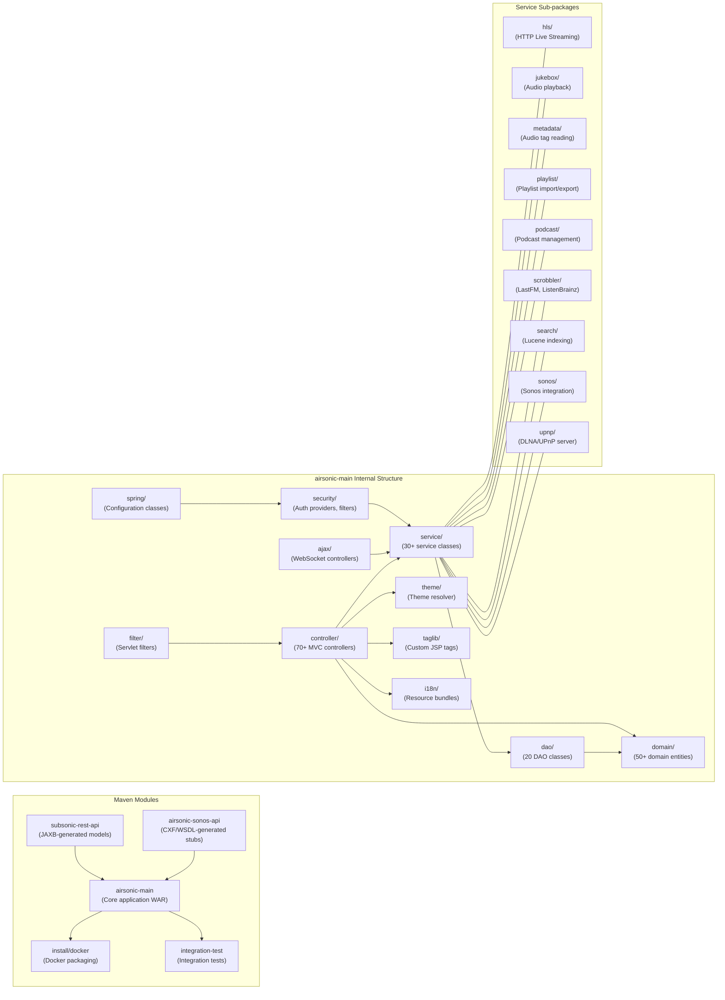

# Airsonic Advanced - Architecture Diagram

## Application Architecture

```mermaid
flowchart TD
    subgraph Clients["Client Layer"]
        WebUI["Web Browser (JSP UI)"]
        SubsonicClient["Subsonic-Compatible Clients"]
        SonosDevice["Sonos Devices"]
        DLNADevice["UPnP/DLNA Devices"]
        WSClient["WebSocket Clients"]
    end

    subgraph Presentation["Presentation Layer"]
        JSPViews["JSP Views\n(/WEB-INF/jsp/)"]
        Controllers["Spring MVC Controllers\n(70+ controllers)"]
        AjaxWS["WebSocket Controllers\n(STOMP over SockJS)"]
        RESTApi["Subsonic REST API\n(/rest/*)"]
        SonosWS["Sonos SOAP/WSDL Endpoint\n(/ws/Sonos)"]
        Filters["Servlet Filters\n(Bootstrap, Encoding, REST, Metrics)"]
    end

    subgraph Security["Security Layer"]
        SpringSec["Spring Security"]
        JWTAuth["JWT Authentication"]
        LDAPAuth["LDAP Authentication"]
        MultiCreds["Multi-Credential Auth Provider"]
        CSRF["CSRF Protection"]
        CORS["CORS Configuration"]
    end

    subgraph Business["Service Layer"]
        MediaSvc["MediaFileService\nMediaScannerService"]
        PlayerSvc["PlayerService\nPlayQueueService"]
        StreamSvc["StreamController\nTranscodingService\nHLSController"]
        SearchSvc["SearchService\n(Lucene-based)"]
        PodcastSvc["PodcastService"]
        PlaylistSvc["PlaylistService"]
        ScrobblerSvc["AudioScrobblerService\n(LastFM, ListenBrainz)"]
        UPnPSvc["UPnPService\n(Cling/DLNA)"]
        SonosSvc["SonosService"]
        CoverArtSvc["CoverArtService"]
        SettingsSvc["SettingsService\nConfigurationPropertiesService"]
        SecuritySvc["SecurityService"]
        DatabaseSvc["DatabaseService\n(Backup/Export/Import)"]
        JukeboxSvc["JukeboxService"]
        NetworkSvc["NetworkService\n(NAT-PMP)"]
        VersionSvc["VersionService"]
        TaskSvc["TaskSchedulingService"]
        ShareSvc["ShareService"]
    end

    subgraph Caching["Caching Layer"]
        EhCache["Ehcache 3 (JSR-107)\n(User, MediaFile, CoverArt,\nPlaylist caches)"]
    end

    subgraph DataAccess["Data Access Layer"]
        DAOs["Spring JDBC DAOs\n(20 DAO classes)"]
        Liquibase["Liquibase\n(Schema Migration)"]
    end

    subgraph DataStorage["Data Storage"]
        HSQLDB["HSQLDB\n(Default embedded)"]
        PostgreSQL["PostgreSQL\n(External option)"]
        MySQL["MySQL / MariaDB\n(External option)"]
        LuceneIdx["Lucene Index\n(Full-text search)"]
        FileSystem["File System\n(Music files, Cover art,\nPodcast downloads, Backups)"]
    end

    subgraph External["External Services"]
        LastFM["Last.fm API\n(Scrobbling, Artist info)"]
        ListenBrainz["ListenBrainz API\n(Scrobbling)"]
        LDAPServer["LDAP Server\n(Optional auth)"]
        PodcastFeeds["Podcast RSS Feeds"]
        Captcha["reCAPTCHA v2"]
    end

    %% Client connections
    WebUI -->|HTTP/HTTPS| Filters
    SubsonicClient -->|REST API| Filters
    SonosDevice -->|SOAP/WSDL| SonosWS
    DLNADevice -->|UPnP/SSDP| UPnPSvc
    WSClient -->|WebSocket/STOMP| AjaxWS

    %% Presentation flow
    Filters --> Controllers
    Filters --> RESTApi
    Controllers --> JSPViews
    Controllers --> Security
    RESTApi --> Security
    SonosWS --> Security
    AjaxWS --> Security

    %% Security to Service
    Security --> SpringSec
    SpringSec --> JWTAuth
    SpringSec --> LDAPAuth
    SpringSec --> MultiCreds
    SpringSec --> CSRF
    SpringSec --> CORS

    %% Controller to Service
    Controllers --> MediaSvc
    Controllers --> PlayerSvc
    Controllers --> StreamSvc
    Controllers --> SearchSvc
    Controllers --> PodcastSvc
    Controllers --> PlaylistSvc
    Controllers --> CoverArtSvc
    Controllers --> SettingsSvc
    Controllers --> DatabaseSvc
    RESTApi --> MediaSvc
    RESTApi --> PlayerSvc
    RESTApi --> StreamSvc
    RESTApi --> SearchSvc
    AjaxWS --> PlayerSvc
    AjaxWS --> MediaSvc
    SonosWS --> SonosSvc

    %% Service to Cache
    MediaSvc --> EhCache
    CoverArtSvc --> EhCache
    SecuritySvc --> EhCache
    PlaylistSvc --> EhCache

    %% Service to DAO
    MediaSvc --> DAOs
    PlayerSvc --> DAOs
    PodcastSvc --> DAOs
    PlaylistSvc --> DAOs
    SecuritySvc --> DAOs
    CoverArtSvc --> DAOs
    ShareSvc --> DAOs
    DatabaseSvc --> DAOs

    %% DAO to Storage
    DAOs --> HSQLDB
    DAOs --> PostgreSQL
    DAOs --> MySQL
    Liquibase --> HSQLDB
    Liquibase --> PostgreSQL
    Liquibase --> MySQL

    %% Service to File System / Index
    SearchSvc --> LuceneIdx
    MediaSvc --> FileSystem
    StreamSvc --> FileSystem
    CoverArtSvc --> FileSystem
    PodcastSvc --> FileSystem
    DatabaseSvc --> FileSystem

    %% Service to External
    ScrobblerSvc --> LastFM
    ScrobblerSvc --> ListenBrainz
    LDAPAuth --> LDAPServer
    PodcastSvc --> PodcastFeeds
    SecuritySvc --> Captcha
```

## Component Relationships

## Technology Stack Summary

| Layer | Technology | Version | Notes |
|-------|-----------|---------|-------|
| **Language** | Java | 21 | LTS release |
| **Framework** | Spring Boot | 3.3.7 | Parent POM |
| **Web** | Spring MVC + Embedded Tomcat | (managed) | WAR packaging, JSP views |
| **View Engine** | JSP + JSTL | 3.1.1 (JSP API) | Server-side rendered UI |
| **WebSocket** | Spring WebSocket + STOMP | (managed) | SockJS fallback |
| **Security** | Spring Security | (managed) | Form login, JWT, LDAP, HTTP Basic |
| **JWT** | Auth0 java-jwt | 3.15.0 | Token-based auth for REST/external |
| **Database (default)** | HSQLDB | 2.5.0 | Embedded file-based |
| **Database (external)** | PostgreSQL, MySQL, MariaDB | (managed) | Production alternatives |
| **Data Access** | Spring JDBC (JdbcTemplate) | (managed) | No ORM; raw DAO pattern |
| **Schema Migration** | Liquibase | 4.31.0 | XML changelogs |
| **Caching** | Ehcache 3 (JSR-107) | (managed) | AspectJ-woven cache advice |
| **Search** | Apache Lucene | 8.9.0 | Full-text music search |
| **SOAP/WSDL** | Apache CXF | 4.0.5 | Sonos API integration |
| **XML Binding** | JAXB (Jakarta XML Bind) | (managed) | REST API models from XSD |
| **UPnP/DLNA** | Cling | 2.0.1 | Media server discovery/streaming |
| **Audio Metadata** | JAudioTagger | 3.0.1 | ID3/Vorbis/FLAC tag reading |
| **Playlist Parsing** | Chameleon | 2.0.0 | M3U/PLS/XSPF support |
| **Scrobbling** | lastfm-java | 0.1.2 | Last.fm integration |
| **Metrics** | Dropwizard Metrics | 4.2.29 | JMX-exposed metrics |
| **Actuator** | Spring Boot Actuator | (managed) | Health, metrics, caches endpoints |
| **AOP** | Spring Aspects + AspectJ | (managed) | Compile-time weaving |
| **Build** | Maven | - | Multi-module reactor build |
| **Packaging** | Docker (fabric8 plugin) | 0.34.1 | Container image build |

## Data Storage & External Services

**Primary Database:** The application defaults to an embedded HSQLDB file-based database, suitable for single-user or small deployments. For production use, PostgreSQL, MySQL, and MariaDB are supported as external database backends. All schema management is handled through Liquibase XML changelogs spanning from legacy schema version 2.5 through the current 11.0 release, ensuring seamless upgrades across versions. The data access layer uses Spring JDBC with a custom `AbstractDao` base class (no JPA/Hibernate ORM).

**Full-Text Search:** Apache Lucene 8.9 provides indexing and search over the music library (artists, albums, songs). The search index is stored on the local file system alongside the application data directory.

**File System Storage:** Music files are read from user-configured "Music Folders" on the host file system. The application also stores podcast downloads, cover art images, database backups (ZIP archives), and the Lucene index under the Airsonic home directory (`~/.airsonic` by default).

**Caching:** Ehcache 3 is used with JSR-107 integration and AspectJ compile-time weaving. Named caches include: `userCache`, `userSettingsCache`, `mediaFilePathCache`, `mediaFileIdCache`, `coverArtCache`, `playlistCache`, and `playlistUsersCache` -- all heap-based with TTL-based expiry.

**External Services:**
- **Last.fm** -- Artist biography, similar artists, album notes, and scrobbling
- **ListenBrainz** -- Music listening history scrobbling
- **LDAP** -- Optional external authentication directory
- **Podcast RSS Feeds** -- Periodic download and management of podcast episodes
- **Google reCAPTCHA v2** -- Account recovery protection

## Key Architectural Decisions

1. **Monolithic WAR with Embedded Tomcat:** The application is packaged as a single executable WAR file using Spring Boot's embedded Tomcat. This simplifies deployment (single JAR/WAR) while retaining the ability to deploy to an external servlet container.

2. **Server-Side Rendering with JSP:** The web UI uses traditional JSP pages with JSTL tags, Spring Security taglibs, and custom taglibs. WebSocket (STOMP/SockJS) provides real-time updates for play queues, now-playing status, and database operations.

3. **Spring JDBC over ORM:** Data access is implemented with raw `JdbcTemplate` via a custom `AbstractDao` base class rather than JPA/Hibernate. This gives full control over SQL queries at the cost of more boilerplate, and makes the existing codebase tightly coupled to specific SQL dialects.

4. **Subsonic API Compatibility:** The `subsonic-rest-api` module generates Java model classes from an XSD schema via JAXB, maintaining wire compatibility with the Subsonic/Airsonic REST API ecosystem (hundreds of third-party clients).

5. **Sonos Integration via SOAP/WSDL:** The `airsonic-sonos-api` module uses Apache CXF to generate service stubs from a Sonos WSDL definition, providing native Sonos speaker integration.

6. **UPnP/DLNA via Cling:** The embedded UPnP/DLNA media server uses the Cling library (pinned to 2.0.1 for Tomcat transport compatibility), enabling discovery and streaming on local networks.

7. **Multi-Database Support with Liquibase:** Schema migrations are managed declaratively through Liquibase XML changelogs, enabling transparent support for HSQLDB, PostgreSQL, MySQL, and MariaDB without code changes.

8. **AspectJ Compile-Time Weaving:** Caching annotations are processed via AspectJ compile-time weaving (not Spring proxy-based AOP), allowing cache annotations to work on self-invocations within the same class.

9. **JWT for Stateless External Access:** External/shared streaming links and the Sonos integration use JWT tokens for stateless authentication, avoiding session management for machine-to-machine or embedded player scenarios.

10. **File-System-Centric Media Management:** All media (music, podcasts, cover art) is managed directly on the file system with a `PathWatcherService` for real-time change detection, rather than storing binary content in the database.
