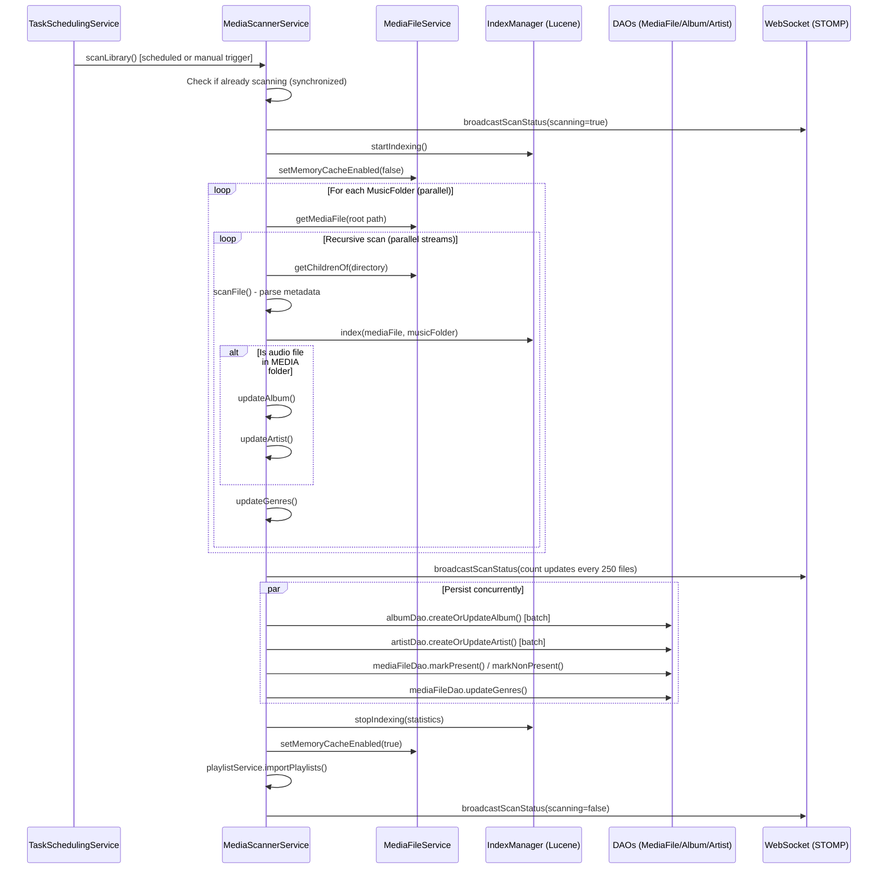
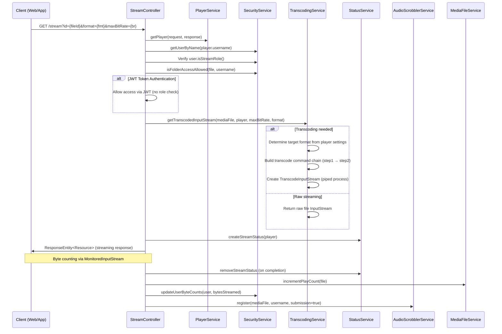
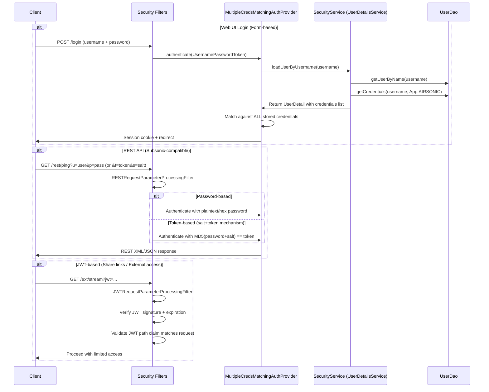
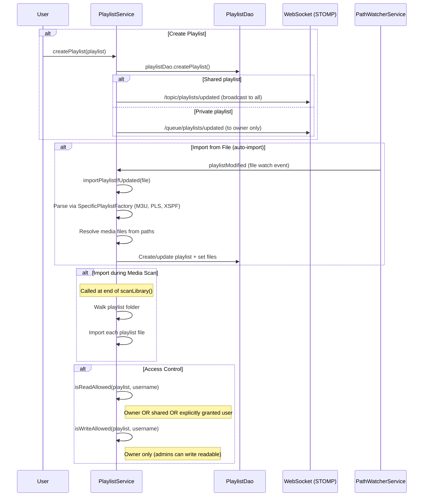
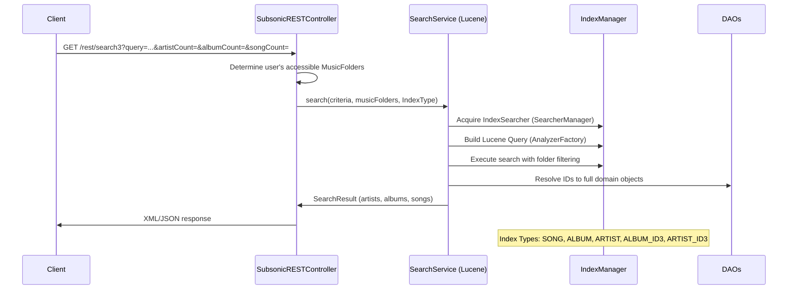
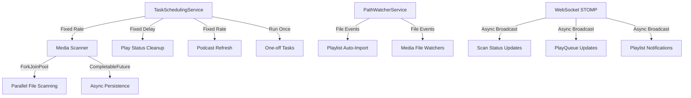

# Business Workflows - Airsonic Advanced

## 1. Business Domain Overview

Airsonic Advanced is a personal music streaming server (fork of Airsonic/Subsonic) built on Java 21 and Spring Boot 3.3.7. It provides a multi-user platform for organizing, browsing, and streaming a personal music library over the network.

### Core Business Domains

| Domain | Description | Key Services |
|--------|-------------|--------------|
| **Media Library** | Scanning, indexing, and organizing music files from the filesystem | `MediaScannerService`, `MediaFileService`, `MediaFolderService`, `CoverArtService` |
| **Music Streaming** | Real-time audio transcoding and delivery to players | `TranscodingService`, `PlayerService`, `PlayQueueService`, `StatusService` |
| **User Management** | Authentication, authorization, and role-based access control | `SecurityService`, `SettingsService` |
| **Playlists** | Creating, managing, importing/exporting playlists | `PlaylistService` |
| **Search** | Full-text Lucene-based search across artists, albums, songs | `SearchService`, `IndexManager` |
| **Podcasts** | RSS feed subscription, episode download, and playback | `PodcastService` |
| **Scrobbling** | Integration with Last.fm and ListenBrainz for play tracking | `AudioScrobblerService` |
| **Sharing** | Public share links with JWT-based authentication | `ShareService`, `JWTSecurityService` |
| **Internet Radio** | Streaming internet radio stations | `InternetRadioService` |
| **UPnP/DLNA** | Media server discovery and streaming via UPnP protocol | `UPnPService` |
| **Sonos** | Integration with Sonos speaker systems | `SonosService` |

### Domain Model (Key Entities)

```
MediaFile (song/album/directory)
  ├── Album (ID3-based album entity)
  ├── Artist (ID3-based artist entity)
  ├── Genre
  └── CoverArt

User
  ├── UserCredential (multi-credential, multi-app)
  ├── UserSettings (preferences)
  └── Role (ADMIN, STREAM, DOWNLOAD, UPLOAD, PLAYLIST, etc.)

Player (client device)
  ├── PlayQueue (current playback state)
  ├── Transcoding (format conversion rules)
  └── TransferStatus (active stream status)

MusicFolder (library root paths)
  └── Type: MEDIA | PODCAST

Playlist
Bookmark
PodcastChannel → PodcastEpisode
InternetRadio
Share
```

---

## 2. Key Business Workflows

### 2.1 Media Library Scanning

The media scanner is the core background process that discovers, indexes, and maintains the music library state in the database.



**Key Design Decisions:**
- Uses `ForkJoinPool` with configurable parallelism (`MediaScannerParallelism` property)
- Thread priority set to `MIN_PRIORITY` to avoid impacting streaming
- Memory cache disabled during scan to avoid stale reads
- Scan status broadcast via WebSocket (STOMP `/topic/scanStatus`)
- `ConcurrentHashMap` used for thread-safe aggregation of albums/artists/genres
- Marks non-present files after scan (soft-delete pattern)

---

### 2.2 Music Streaming / Playback



**Key Design Decisions:**
- Supports HTTP byte-range requests for seeking
- Transcoding uses OS process piping (ffmpeg/lame)
- Transfer status tracked in-memory (`ConcurrentHashMap`)
- Scrobbling to Last.fm/ListenBrainz happens asynchronously
- Play count incremented on file, parent directory, and album
- Jukebox mode plays audio on the server hardware itself

---

### 2.3 User Authentication & Authorization



**Role-Based Access Control (RBAC):**

| Role | Permissions |
|------|-------------|
| `ADMIN` | Full system access, manage users, settings, all folders |
| `STREAM` | Stream music to player |
| `DOWNLOAD` | Download files |
| `UPLOAD` | Upload files to podcast folders |
| `PLAYLIST` | Create/manage playlists |
| `COVERART` | Change cover art |
| `COMMENT` | Add comments to files |
| `PODCAST` | Manage podcast subscriptions |
| `JUKEBOX` | Control server-side jukebox playback |
| `SHARE` | Create public share links |
| `SETTINGS` | Modify personal settings |

**Credential System:**
- Multiple credentials per user (multi-app: AIRSONIC, LASTFM, LISTENBRAINZ)
- Pluggable password encoders: bcrypt, argon2, scrypt, pbkdf2, AES-GCM (decodable)
- Legacy encoder migration support (legacynoop, legacyhex)
- Credential expiration support
- LDAP authentication integration

---

### 2.4 Playlist Management



**Key Features:**
- Import/export support via Chameleon library (M3U, PLS, XSPF, etc.)
- File system watcher for automatic playlist import on file changes
- Real-time WebSocket notifications for playlist updates/deletions
- Admin users can modify all visible playlists
- Playlist stats (file count, duration) auto-calculated on changes

---

### 2.5 Search Functionality



**Search Architecture:**
- Apache Lucene for full-text indexing (version-tracked schema, currently v19)
- Indexes maintained during media library scan (`IndexManager.index()`)
- Supports both filesystem-based browsing (SONG/ALBUM/ARTIST) and ID3-based (ALBUM_ID3/ARTIST_ID3)
- Random song/album retrieval via Lucene
- Folder-level access filtering applied to all search results
- `SearcherManager` for thread-safe concurrent search during indexing

---

## 3. Service Layer Design

### Architecture Pattern

The application follows a **layered architecture**:

```
┌─────────────────────────────────────────────────────────┐
│  Controllers (REST API + Web MVC)                       │
│  StreamController, SubsonicRESTController, etc.         │
├─────────────────────────────────────────────────────────┤
│  Service Layer (Business Logic)                         │
│  @Service annotated classes with @Autowired injection   │
├─────────────────────────────────────────────────────────┤
│  DAO Layer (Data Access)                                │
│  Spring JdbcTemplate-based DAOs extending AbstractDao   │
├─────────────────────────────────────────────────────────┤
│  Database (HSQLDB / external RDBMS via Liquibase)       │
└─────────────────────────────────────────────────────────┘
```

### Service Layer Characteristics

| Pattern | Implementation |
|---------|----------------|
| **Dependency Injection** | Field injection via `@Autowired` (prevalent pattern) |
| **Caching** | Spring `@Cacheable`/`@CacheEvict` on `MediaFileService`, `SecurityService`, `PlaylistService` |
| **Event Broadcasting** | `SimpMessagingTemplate` (WebSocket STOMP) for real-time UI updates |
| **Async Operations** | `CompletableFuture.runAsync()` for non-blocking broadcasts |
| **Circular Dependencies** | `@Lazy` annotation used (e.g., `PlayerService` ↔ `TranscodingService`) |
| **Initialization** | `@PostConstruct` for service setup (scheduling, cleanup, watchers) |
| **Configuration** | `SettingsService` as centralized config store (DB-backed properties) |

### Key Service Dependencies

```
MediaScannerService
  ├── MediaFileService (file metadata management)
  ├── MediaFolderService (folder configuration)
  ├── IndexManager (Lucene indexing)
  ├── CoverArtService (album art persistence)
  ├── PlaylistService (post-scan import)
  ├── TaskSchedulingService (cron scheduling)
  └── SimpMessagingTemplate (WebSocket status)

StreamController
  ├── PlayerService (player resolution)
  ├── SecurityService (access control)
  ├── TranscodingService (format conversion)
  ├── StatusService (transfer tracking)
  ├── MediaFileService (file lookup)
  └── AudioScrobblerService (play registration)

PlayQueueService
  ├── JukeboxService (server-side playback)
  ├── MediaFileService (file resolution)
  ├── PlaylistService (playlist loading)
  ├── PodcastService (episode resolution)
  ├── InternetRadioService (radio stream URLs)
  └── SimpMessagingTemplate (real-time queue updates)
```

---

## 4. Transaction Management

### Transaction Patterns

Airsonic Advanced uses a **minimal explicit transaction** approach:

| Aspect | Implementation |
|--------|----------------|
| **Transaction Demarcation** | Primarily at the DAO layer (Spring JdbcTemplate auto-commit per statement) |
| **No `@Transactional`** | Service layer does NOT use Spring `@Transactional` annotations |
| **Batch Operations** | Media scanner persists in batches via `CompletableFuture.allOf().join()` |
| **Consistency Model** | Eventual consistency; scan marks records then cleans up non-present |
| **Cache Coherence** | `@CacheEvict` used to invalidate caches on writes |
| **Concurrency Control** | `synchronized` methods + `ConcurrentHashMap` for in-memory state |

### Data Consistency Strategies

1. **Soft-Delete Pattern (Media Scanner):**
   - Scan marks all encountered files with `lastScanned` timestamp
   - After scan, `markNonPresent()` sets `present=false` for records not touched
   - Queries filter by `present=true` for user-facing operations

2. **Optimistic Update (MediaFile):**
   - `checkLastModified()` compares DB timestamp with filesystem
   - Re-reads metadata from disk if file is newer
   - `version` field used for schema migration detection

3. **Cache Strategy:**
   - `mediaFilePathCache` / `mediaFileIdCache` - media file lookups
   - `userCache` - user entity caching
   - `playlistCache` / `playlistUsersCache` - playlist caching
   - Caches disabled during full library scan

---

## 5. Scheduled / Background Tasks

### Task Scheduling Infrastructure

The `TaskSchedulingService` wraps Spring's `ScheduledTaskRegistrar` with named task management:

| Task | Schedule | Service | Description |
|------|----------|---------|-------------|
| **Media Library Scan** | Configurable interval (days) + hour | `MediaScannerService` | Full filesystem scan and index rebuild |
| **Remote Play Status Cleanup** | Every 3 hours | `StatusService` | Removes stale remote play statuses |
| **Podcast Refresh** | Configurable interval per channel | `PodcastService` | Checks RSS feeds for new episodes |
| **Podcast Download** | On new episode detection | `PodcastService` | Downloads episode audio files |
| **Player Cleanup** | On startup (@PostConstruct) | `PlayerService` | Deletes players not seen in 60 days |

### Background Processing Patterns



### File System Watching

`PathWatcherService` uses Java NIO `WatchService` for real-time filesystem monitoring:
- Dedicated single-thread executor for watch polling
- Cached thread pool for executing watch event handlers
- Used for automatic playlist import when files change in playlist folder
- Named watchers with cancellation support

---

## 6. Validation & Business Rules

### User Settings Validation (`UserSettingsValidator`)

| Rule | Constraint |
|------|-----------|
| Username required | Non-empty for new users |
| Username unique | No duplicate usernames |
| Email required | Must be provided for new users |
| Password required | Non-LDAP users must have password |
| Password confirmation | Must match password field |
| LDAP validation | Cannot set password for LDAP users; LDAP must be enabled |
| Self-deletion prevention | Cannot delete currently logged-in user |
| Admin role preservation | Cannot remove admin role from current user |

### Media File Validation Rules

| Rule | Implementation |
|------|----------------|
| File inclusion | Must be recognized audio/video format OR directory |
| File exclusion | Hidden files (`.`), `@eaDir`, `Thumbs.db`, pattern-matched |
| Symlink handling | Configurable ignore via `ignoreSymLinks` setting |
| Folder access | User must have explicit access to the file's `MusicFolder` |
| Write access | Only podcast folders or `cover.*` files are writable |
| Upload validation | Must be in a writable music folder; file must not exist |

### Streaming Access Rules

| Rule | Enforcement |
|------|-------------|
| Stream role required | User must have `STREAM` role (bypassed with JWT) |
| Folder access required | User must have access to the file's music folder |
| Bit rate limits | Configurable per-player maximum bit rate |
| Transcoding rules | Per-player transcoding configuration determines output format |

### Playlist Access Control

| Operation | Rule |
|-----------|------|
| Read | Owner OR `shared=true` OR explicitly granted user |
| Write | Owner only (admins can write any readable playlist) |
| Delete | Owner only |

### Credential Business Rules

| Rule | Implementation |
|------|----------------|
| Minimum one Airsonic credential | Cannot delete last AIRSONIC app credential |
| Credential expiration | Credentials have optional `expiration` timestamp |
| Encoder migration | Legacy encoders can be migrated to non-legacy by admin |
| Default admin detection | Warns if admin/admin credentials still present |
| Open-text credential detection | Warns if plaintext passwords exist in DB |

### Bookmark Rules

- Bookmarks auto-deleted when position is within 60 seconds of track end
- One bookmark per user per media file (upsert semantics)

---

## 7. Error Handling Strategy

### General Patterns

| Pattern | Usage |
|---------|-------|
| **Try-catch with logging** | Primary pattern in service layer; exceptions logged at WARN/ERROR |
| **Graceful degradation** | Failed operations (scrobbling, cover art) don't fail the parent operation |
| **Null returns** | Many service methods return `null` for not-found (instead of exceptions) |
| **Spring Security exceptions** | `AccessDeniedException` for authorization failures |
| **REST error responses** | `SubsonicRESTController` uses `@ExceptionHandler` for consistent error XML/JSON |

### Media Scanner Error Handling

```java
// Top-level catch prevents scan failure from crashing the scheduler
try {
    // Full scan logic
} catch (Throwable x) {
    LOG.error("Failed to scan media library.", x);
} finally {
    mediaFileService.setMemoryCacheEnabled(true);
    indexManager.stopIndexing(statistics);
}
```

- Individual file scan failures don't stop the overall scan
- Non-existent files are marked as `present=false` rather than deleted
- IO exceptions during directory listing are logged and skipped

### Streaming Error Handling

- `IOException` during streaming: connection closed, status cleaned up
- Missing files: return appropriate HTTP status
- Transcoding process failures: logged, stream terminated
- Access denied: Spring Security `AccessDeniedException` → 403 response

### Credential Error Handling

- Failed credential migration: logged, collected as failures, returns success=false
- Decode failures: logged at WARN, returns null (non-fatal)
- Ensures at least one AIRSONIC credential always exists (predicate guard)

### WebSocket Broadcasting Error Handling

All WebSocket broadcasts wrapped in `CompletableFuture.runAsync()`:
- Failures in broadcasting don't affect the business operation
- Fire-and-forget pattern for UI notifications

### REST API Error Handling

The `SubsonicRESTController` uses exception handlers to produce standard Subsonic API error responses:
- `MissingServletRequestParameterException` → error code 10 (required parameter missing)
- Generic exceptions → error code 0 (generic error)
- Access control failures → error code 50 (not authorized)

---

## Appendix: Configuration & Settings

### Key Configurable Settings (via `SettingsService`)

| Setting | Purpose |
|---------|---------|
| `indexCreationInterval` | Days between automatic scans (-1 = disabled) |
| `indexCreationHour` | Hour of day for scheduled scan |
| `musicFileTypes` | Recognized audio file extensions |
| `videoFileTypes` | Recognized video file extensions |
| `coverArtFileTypes` | Patterns for cover art detection |
| `coverArtSource` | Priority: FILETAG, TAGFILE, FILE, TAG |
| `excludePattern` | Regex for files to skip during scan |
| `ignoreSymLinks` | Whether to follow symbolic links |
| `fastCacheEnabled` | Minimize disk access for file lookups |
| `playlistFolder` | Path for auto-imported playlists |
| `playlistExportFormat` | Export format (M3U, PLS, XSPF) |
| `podcastFolder` | Path for downloaded podcast episodes |
| `decodablePasswordEncoder` | Default encoder for reversible credentials |
| `nonDecodablePasswordEncoder` | Default encoder for one-way credentials |
| `ldapEnabled` | LDAP authentication toggle |
| `genreSeparators` | Characters used to split multi-genre tags |

### Actuator Endpoints

- `/actuator/customscheduledtasks` - View all registered scheduled tasks with metadata and run history
