# Data Architecture Assessment - Airsonic Advanced

## 1. Data Model Overview

Airsonic Advanced uses a **traditional DAO pattern** with Spring JDBC (`JdbcTemplate` / `NamedParameterJdbcTemplate`) for data access. Domain objects are **plain POJOs** (no JPA/Hibernate annotations). The default database is HSQLDB (embedded), with support for PostgreSQL and MySQL/MariaDB.

### Entity Relationship Diagram

```mermaid
erDiagram
    USERS {
        varchar username PK
        varchar email
        boolean ldap_authenticated
        bigint bytes_streamed
        bigint bytes_downloaded
        bigint bytes_uploaded
        json roles
    }

    USER_CREDENTIALS {
        varchar username FK
        varchar app_username
        varchar credential
        varchar encoder
        varchar app
        varchar comment
        timestamp expiration
        timestamp created
        timestamp updated
    }

    USER_SETTINGS {
        varchar username FK
        json settings
    }

    MUSIC_FOLDER {
        int id PK
        varchar path
        varchar name
        varchar type
        boolean enabled
        timestamp changed
    }

    MUSIC_FOLDER_USER {
        int music_folder_id FK
        varchar username FK
    }

    MEDIA_FILE {
        int id PK
        varchar path
        int folder_id FK
        varchar type
        varchar format
        varchar title
        varchar album
        varchar artist
        varchar album_artist
        int disc_number
        int track_number
        int year
        varchar genre
        int bit_rate
        boolean variable_bit_rate
        double duration
        bigint file_size
        int width
        int height
        varchar parent_path
        int play_count
        timestamp last_played
        varchar comment
        timestamp created
        timestamp changed
        timestamp last_scanned
        timestamp children_last_updated
        boolean present
        int version
        varchar mb_release_id
        varchar mb_recording_id
    }

    ALBUM {
        int id PK
        varchar path
        varchar name
        varchar artist
        int song_count
        double duration
        int year
        varchar genre
        int play_count
        timestamp last_played
        varchar comment
        timestamp created
        timestamp last_scanned
        boolean present
        int folder_id FK
        varchar mb_release_id
    }

    ARTIST {
        int id PK
        varchar name
        int album_count
        timestamp last_scanned
        boolean present
        int folder_id FK
    }

    PLAYER {
        int id PK
        varchar name
        varchar technology
        varchar client_id
        varchar type
        varchar username FK
        varchar ip_address
        boolean dynamic_ip
        boolean auto_control_enabled
        boolean m3u_bom_enabled
        timestamp last_seen
        varchar transcode_scheme
    }

    PLAYLIST {
        int id PK
        varchar username FK
        boolean is_public
        varchar name
        varchar comment
        int file_count
        double duration
        timestamp created
        timestamp changed
        varchar imported_from
    }

    PLAYLIST_FILE {
        int id PK
        int playlist_id FK
        int media_file_id FK
    }

    PLAYLIST_USER {
        int playlist_id FK
        varchar username FK
    }

    PODCAST_CHANNEL {
        int id PK
        varchar url
        varchar title
        text description
        varchar image_url
        varchar status
        varchar error_message
        int media_file_id FK
    }

    PODCAST_EPISODE {
        int id PK
        int channel_id FK
        varchar episode_guid
        varchar url
        int media_file_id FK
        varchar title
        text description
        timestamp publish_date
        varchar duration
        bigint bytes_total
        bigint bytes_downloaded
        varchar status
        varchar error_message
    }

    PODCAST_CHANNEL_RULES {
        int id FK
        int check_interval
        int retention_count
        int download_count
    }

    SHARE {
        int id PK
        varchar name
        varchar description
        varchar username FK
        timestamp created
        timestamp expires
        timestamp last_visited
        int visit_count
    }

    SHARE_FILE {
        int share_id FK
        int media_file_id FK
    }

    BOOKMARK {
        int id PK
        int media_file_id FK
        bigint position_millis
        varchar username FK
        varchar comment
        timestamp created
        timestamp changed
    }

    INTERNET_RADIO {
        int id PK
        varchar name
        varchar stream_url
        varchar homepage_url
        boolean enabled
        timestamp changed
    }

    TRANSCODING {
        int id PK
        varchar name
        varchar source_formats
        varchar target_format
        varchar step1
        varchar step2
        varchar step3
        boolean default_active
    }

    PLAYER_TRANSCODING {
        int player_id FK
        int transcoding_id FK
    }

    PLAY_QUEUE {
        int id PK
        varchar username FK
        int current_media_file_id FK
        bigint position_millis
        timestamp changed
        varchar changed_by
    }

    PLAY_QUEUE_FILE {
        int id PK
        int play_queue_id FK
        int media_file_id FK
    }

    COVER_ART {
        int entity_id
        varchar entity_type
        varchar path
        int folder_id FK
        boolean overridden
        timestamp created
        timestamp updated
    }

    STARRED_MEDIA_FILE {
        int id PK
        int media_file_id FK
        varchar username FK
        timestamp created
    }

    STARRED_ALBUM {
        int id PK
        int album_id FK
        varchar username FK
        timestamp created
    }

    STARRED_ARTIST {
        int id PK
        int artist_id FK
        varchar username FK
        timestamp created
    }

    USER_RATING {
        varchar username FK
        int media_file_id FK
        int rating
    }

    GENRE {
        varchar name PK
        int song_count
        int album_count
    }

    CUSTOM_AVATAR {
        int id PK
        varchar name
        timestamp created_date
        varchar mime_type
        int width
        int height
        varchar path
    }

    SONOSLINK {
        varchar username FK
        varchar linkcode
        varchar household_id
        varchar initiator
        timestamp initiated
    }

    %% Relationships
    USERS ||--o{ USER_CREDENTIALS : "has credentials"
    USERS ||--o| USER_SETTINGS : "has settings"
    USERS ||--o{ PLAYER : "owns"
    USERS ||--o{ PLAYLIST : "owns"
    USERS ||--o{ BOOKMARK : "has"
    USERS ||--o{ SHARE : "creates"
    USERS ||--o{ STARRED_MEDIA_FILE : "stars"
    USERS ||--o{ STARRED_ALBUM : "stars"
    USERS ||--o{ STARRED_ARTIST : "stars"
    USERS ||--o{ USER_RATING : "rates"
    USERS ||--o{ MUSIC_FOLDER_USER : "accesses"
    USERS ||--o{ PLAY_QUEUE : "has"
    USERS ||--o{ SONOSLINK : "links"
    USERS ||--o{ PLAYLIST_USER : "shared with"

    MUSIC_FOLDER ||--o{ MEDIA_FILE : "contains"
    MUSIC_FOLDER ||--o{ ALBUM : "contains"
    MUSIC_FOLDER ||--o{ ARTIST : "contains"
    MUSIC_FOLDER ||--o{ MUSIC_FOLDER_USER : "assigned to"

    MEDIA_FILE ||--o{ PLAYLIST_FILE : "in playlists"
    MEDIA_FILE ||--o{ SHARE_FILE : "in shares"
    MEDIA_FILE ||--o{ BOOKMARK : "bookmarked"
    MEDIA_FILE ||--o{ STARRED_MEDIA_FILE : "starred"
    MEDIA_FILE ||--o{ USER_RATING : "rated"
    MEDIA_FILE ||--o{ PLAY_QUEUE_FILE : "in queues"

    PLAYLIST ||--o{ PLAYLIST_FILE : "contains"
    PLAYLIST ||--o{ PLAYLIST_USER : "shared with"

    SHARE ||--o{ SHARE_FILE : "contains"

    PODCAST_CHANNEL ||--o{ PODCAST_EPISODE : "has episodes"
    PODCAST_CHANNEL ||--o| PODCAST_CHANNEL_RULES : "has rules"

    PLAYER ||--o{ PLAYER_TRANSCODING : "uses"
    TRANSCODING ||--o{ PLAYER_TRANSCODING : "assigned to"

    PLAY_QUEUE ||--o{ PLAY_QUEUE_FILE : "contains"

    ALBUM ||--o{ STARRED_ALBUM : "starred"
    ARTIST ||--o{ STARRED_ARTIST : "starred"
```



## 2. Entity Details

### Core Media Entities

| Domain Class | Table Name | Primary Key | Description |
|---|---|---|---|
| `MediaFile` | `media_file` | `id` (auto-increment int) | Central entity: files, directories, and albums in the music library |
| `Album` | `album` | `id` (auto-increment int) | Aggregated album metadata (ID3-derived) |
| `Artist` | `artist` | `id` (auto-increment int) | Aggregated artist metadata |
| `Genre` | `genre` | `name` (varchar) | Genre with song/album counts |
| `CoverArt` | `cover_art` | Composite: `entity_id` + `entity_type` | Cover art references for media files, albums, artists |
| `MusicFolder` | `music_folder` | `id` (auto-increment int) | Top-level media library directories |

### User & Authentication Entities

| Domain Class | Table Name | Primary Key | Description |
|---|---|---|---|
| `User` | `users` | `username` (varchar) | User accounts with roles stored as JSON |
| `UserCredential` | `user_credentials` | Composite (username, app, created) | Credentials for multiple apps (Airsonic, Last.fm, ListenBrainz, PodcastIndex) |
| `UserSettings` | `user_settings` | `username` (varchar FK) | User preferences serialized as JSON |
| `Avatar` | `custom_avatar` | `id` (auto-increment int) | Custom user avatar images |

### Player & Streaming Entities

| Domain Class | Table Name | Primary Key | Description |
|---|---|---|---|
| `Player` | `player` | `id` (auto-increment int) | Remote/web player clients |
| `Transcoding` | `transcoding` | `id` (auto-increment int) | Audio format conversion pipelines |
| `SavedPlayQueue` | `play_queue` | `id` (auto-increment int) | Persisted play queue state per user |
| `InternetRadio` | `internet_radio` | `id` (auto-increment int) | Internet radio station definitions |

### Playlist & Social Entities

| Domain Class | Table Name | Primary Key | Description |
|---|---|---|---|
| `Playlist` | `playlist` | `id` (auto-increment int) | Named media file collections |
| `Share` | `share` | `id` (auto-increment int) | Publicly accessible media collections via URL |
| `Bookmark` | `bookmark` | `id` (auto-increment int) | User playback position markers |
| `SonosLink` | `sonoslink` | Composite (username, householdId) | Sonos speaker integration links |

### Podcast Entities

| Domain Class | Table Name | Primary Key | Description |
|---|---|---|---|
| `PodcastChannel` | `podcast_channel` | `id` (auto-increment int) | Podcast feed subscriptions |
| `PodcastEpisode` | `podcast_episode` | `id` (auto-increment int) | Individual podcast episodes |
| `PodcastChannelRule` | `podcast_channel_rules` | `id` (FK to podcast_channel) | Per-channel download/retention rules |

### Join/Association Tables

| Table Name | Purpose |
|---|---|
| `playlist_file` | Playlist-to-MediaFile many-to-many |
| `playlist_user` | Playlist sharing with specific users |
| `share_file` | Share-to-MediaFile many-to-many |
| `player_transcoding` | Player-to-Transcoding many-to-many |
| `play_queue_file` | PlayQueue-to-MediaFile many-to-many |
| `music_folder_user` | MusicFolder access per user |
| `starred_media_file` | User media file favorites |
| `starred_album` | User album favorites |
| `starred_artist` | User artist favorites |
| `user_rating` | User ratings (1-5) for media files |

## 3. Data Access Patterns

### Architecture: DAO Pattern with Spring JDBC

The project does **NOT** use JPA/Hibernate. Instead, it uses a custom DAO layer built on Spring JDBC:

```
Controller/Service Layer
        |
   DAO Layer (extends AbstractDao)
        |
   Spring JdbcTemplate / NamedParameterJdbcTemplate
        |
   JDBC DataSource
```

### AbstractDao Base Class

Location: `org.airsonic.player.dao.AbstractDao`

Provides:
- **JdbcTemplate** and **NamedParameterJdbcTemplate** injection
- Type conversion utilities (`Instant` -> `Timestamp`, `Enum` -> `String`, `Path` -> `String`)
- Generic CRUD helpers: `query()`, `update()`, `namedUpdate()`, `batchedUpdate()`
- Convenience methods: `queryForInt()`, `queryForInstant()`, `queryForStrings()`
- **Reflection-based insert mechanism** using `SimpleJdbcInsert` with `MethodHandle`-based field extraction
- Custom `@Column` annotation for field-to-column name mapping

### DAO Implementations

| DAO Class | Domain Entity | Key Operations |
|---|---|---|
| `MediaFileDao` | `MediaFile` | CRUD, search by path/folder, starred queries, genre queries, random songs |
| `UserDao` | `User`, `UserCredential`, `UserSettings` | User CRUD, credentials management, settings storage |
| `AlbumDao` | `Album` | Album CRUD, starred albums, alphabetical/year/genre queries |
| `ArtistDao` | `Artist` | Artist CRUD, starred artists |
| `PlayerDao` | `Player` | Player CRUD, lookup by username/client/technology |
| `PlaylistDao` | `Playlist` | Playlist CRUD, file management, user sharing |
| `PodcastDao` | `PodcastChannel`, `PodcastEpisode`, `PodcastChannelRule` | Podcast subscription management |
| `BookmarkDao` | `Bookmark` | Playback position bookmarks |
| `ShareDao` | `Share` | Public share management |
| `InternetRadioDao` | `InternetRadio` | Radio station CRUD |
| `TranscodingDao` | `Transcoding` | Transcoding configuration management |
| `MusicFolderDao` | `MusicFolder` | Music library folder CRUD |
| `CoverArtDao` | `CoverArt` | Cover art reference management |
| `AvatarDao` | `Avatar` | User avatar management |
| `RatingDao` | (ratings) | User rating management, highest-rated queries |
| `PlayQueueDao` | `SavedPlayQueue` | Persisted play queue state |
| `SonosLinkDao` | `SonosLink` | Sonos device linking |
| `DatabaseDao` | (utility) | Database export/import operations |

### Row Mapping Strategy

Each DAO contains inner `RowMapper<T>` implementations that manually map `ResultSet` columns to domain POJO fields:

```java
private static class MediaFileMapper implements RowMapper<MediaFile> {
    @Override
    public MediaFile mapRow(ResultSet rs, int rowNum) throws SQLException {
        return new MediaFile(
            rs.getInt("id"),
            rs.getString("path"),
            rs.getInt("folder_id"),
            MediaFile.MediaType.valueOf(rs.getString("type")),
            // ... manual field mapping
        );
    }
}
```

### Transaction Management

- Uses Spring `@Transactional` annotations at the DAO/Service level
- Isolation level `READ_COMMITTED` used for critical upsert operations (e.g., `MediaFileDao.createOrUpdateMediaFile()`)
- Batch operations use `JdbcTemplate.batchUpdate()` with configurable batch sizing (30000 / param count)

### Full-Text Search (Lucene)

Separate from the SQL database, Airsonic uses **Apache Lucene** for full-text search:

| Component | Purpose |
|---|---|
| `IndexManager` | Manages Lucene index lifecycle and write operations |
| `SearchServiceImpl` | Executes search queries against the Lucene index |
| `DocumentFactory` | Converts domain objects to Lucene Documents |
| `AnalyzerFactory` | Configures Lucene analyzers (CJK, ASCII folding, stop words) |
| `QueryFactory` | Builds Lucene queries from search criteria |
| `IndexType` | Enumerates index types: SONG, ALBUM, ARTIST |

The Lucene index is stored on the filesystem under `${airsonic.home}/lucene/` and is rebuilt during media library scans.

## 4. Database Configuration

### Default Configuration (HSQLDB Embedded)

```properties
spring.datasource.url=jdbc:hsqldb:file:${airsonic.home}/db/airsonic;hsqldb.tx=mvcc;sql.enforce_size=false;sql.char_literal=false;sql.nulls_first=false;sql.pad_space=false;hsqldb.defrag_limit=50;shutdown=true
spring.datasource.username=sa
spring.datasource.password=
```

### Supported Databases

| Database | Support Level | Configuration |
|---|---|---|
| **HSQLDB** | Default (embedded) | No additional config required |
| **PostgreSQL** | Full support | Custom `binary_type=bytea`, rand() function shim |
| **MySQL/MariaDB** | Full support | Custom `varchar_type`, `datetime(6)` timestamps, configurable varchar limit |

### Configuration Properties

| Property | Description |
|---|---|
| `spring.datasource.url` | JDBC connection URL |
| `spring.datasource.username` | Database username |
| `spring.datasource.password` | Database password |
| `spring.datasource.driver-class-name` | JDBC driver class |
| `spring.datasource.jndi-name` | JNDI name (overrides direct connection) |
| `spring.liquibase.change-log` | Liquibase changelog location (`classpath:liquibase/db-changelog.xml`) |
| `spring.liquibase.rollback-file` | Rollback SQL output file |
| `spring.liquibase.parameters.mysqlVarcharLimit` | MySQL varchar length limit (default: 384) |

### Database Backup (HSQLDB only)

The `DatabaseService` provides:
- Scheduled automatic backups at configurable intervals
- Manual backup/export to Liquibase XML changesets
- Import from Liquibase XML changesets
- Backup retention management (configurable count)

## 5. Migration Strategy (Liquibase)

### Changelog Structure

```
liquibase/db-changelog.xml (master)
  |-- legacy/legacy-changelog.xml
  |     |-- schema25.xml through schema100.xml (26 files)
  |-- 6.2/changelog.xml
  |-- 6.3/changelog.xml
  |-- 6.4/changelog.xml
  |-- 10.6/changelog.xml
  |     |-- user-credentials.xml
  |     |-- timestamp-precision.xml
  |     |-- support-listenbrainz.xml
  |     |-- expand-durations.xml
  |     |-- add-media-file-mb-recording-id.xml
  |-- 11.0/changelog.xml (30 migrations)
        |-- relative-media-file-paths.xml
        |-- media-file-music-folder-link.xml
        |-- cover-art-table.xml
        |-- avatar-storage.xml
        |-- podcast-channel-rules.xml
        |-- user-settings-json.xml
        |-- user-roles-json.xml
        |-- move-user-table.xml
        |-- explicit-fk-indices.xml
        |-- ... and more
```

### Migration Versioning

| Version | Era | Notable Changes |
|---|---|---|
| Legacy (schema25-100) | Subsonic/Airsonic original | Initial schema creation, incremental additions |
| 6.2 - 6.4 | Airsonic fork | Various schema refinements |
| 10.6 | Airsonic Advanced | User credentials table, timestamp precision, ListenBrainz, MusicBrainz IDs |
| 11.0 | Current | Major restructuring: relative paths, folder links, cover art table, JSON settings, avatar storage, PostgreSQL support, FK indices |

### Cross-Database Compatibility

The master changelog defines DB-specific property variables:

```xml
<property name="binary_type" dbms="hsqldb" value="binary" />
<property name="binary_type" dbms="postgresql" value="bytea" />
<property name="binary_type" value="blob" />
<property name="timestamp_type" dbms="hsqldb" value="timestamp(9)" />
<property name="timestamp_type" dbms="mysql,mariadb" value="datetime(6)" />
<property name="timestamp_type" value="datetime" />
<property name="varchar_type" dbms="mariadb,mysql" value="varchar(${mysqlVarcharLimit})" />
<property name="varchar_type" value="varchar" />
```

### Migration Execution

- Runs automatically on application startup via Spring Boot Liquibase auto-configuration
- Rollback file generated at `${airsonic.home}/rollback.sql`
- Preconditions used extensively to allow idempotent execution

## 6. Caching Implementation

### Technology: Ehcache 3 (JSR-107 / JCache)

Location: `org.airsonic.player.spring.CacheConfiguration`

Configuration:
- **Spring `@EnableCaching`** with **AspectJ advice mode** (allows self-invocation caching)
- **Heap-only storage**: 1000 entries per cache
- Persistence directory: `${airsonic.home}/cache/`

### Cache Definitions

| Cache Name | Key Type | Value Type | TTL | Purpose |
|---|---|---|---|---|
| `userCache` | `String` (username) | `User` | 2 days | User lookups |
| `userSettingsCache` | `String` (username) | `UserSettings` | 2 days | User preference lookups |
| `mediaFilePathCache` | `String` (path key) | `MediaFile` | 2 hours | Media file lookups by path |
| `mediaFileIdCache` | `Integer` (id) | `MediaFile` | 2 hours | Media file lookups by ID |
| `coverArtCache` | `String` (entity key) | `CoverArt` | 2 days | Cover art reference lookups |
| `playlistCache` | `Integer` (id) | `Playlist` | 10 days | Playlist metadata lookups |
| `playlistUsersCache` | `Integer` (playlist id) | `Object` (user list) | 10 days | Playlist user access lists |

### Cache Event Logging

All caches are instrumented with `CacheLogger` (implements `CacheEventListener`) that logs cache events (create, update, remove, expire) at INFO level.

### Last.fm Cache

Location: `org.airsonic.player.service.LastFmCache`

A separate caching mechanism for Last.fm API responses (artist bios, similar artists, top songs) to reduce external API calls.

## 7. Key Architectural Observations

### Strengths
1. **Simple, proven pattern** - DAO + JDBC is well-understood and performant
2. **Multi-database support** - Liquibase abstracts schema across HSQLDB, PostgreSQL, MySQL/MariaDB
3. **Comprehensive migration history** - Full schema evolution from Subsonic origins
4. **Effective caching** - Ehcache with TTL prevents excessive DB queries for hot data
5. **Separation of concerns** - Lucene handles search, RDBMS handles transactional data

### Considerations for Modernization
1. **No ORM** - Manual RowMapper implementations create significant boilerplate; JPA/Spring Data would reduce code
2. **No Spring Data Repositories** - Despite Spring Boot 3.3.7 base, no use of Spring Data JPA
3. **Composite keys** - Some tables use implicit composite keys without formal constraints
4. **JSON-in-RDBMS** - UserSettings and roles stored as JSON blobs (schema-less within columns)
5. **No connection pooling configuration** - Relies on Spring Boot's default HikariCP auto-configuration
6. **Tight coupling** - DAO classes have direct SQL strings embedded; no query externalization
7. **Legacy table naming** - Mixed conventions (`media_file` vs `sonoslink`, `user` renamed to `users`)
8. **No audit trail** - No change tracking beyond `created`/`changed` timestamps
9. **Soft deletes** - `present` flag used as soft delete on media_file, album, artist (no hard delete during scans)
10. **No database-level FK enforcement in all cases** - Some relationships maintained only by application logic

### Database Table Count

Total: **~30 tables** (including join tables and the Liquibase tracking tables)

### Data Flow Summary

```
Media Scanner -> MediaFileDao -> media_file table
                               -> Lucene Index (search)
                               -> AlbumDao -> album table
                               -> ArtistDao -> artist table
                               -> CoverArtDao -> cover_art table
                               -> GenreDao -> genre table

User Actions -> UserDao -> users / user_credentials / user_settings
             -> PlayerDao -> player
             -> PlaylistDao -> playlist / playlist_file
             -> BookmarkDao -> bookmark
             -> RatingDao -> user_rating
             -> MediaFileDao -> starred_media_file
```
