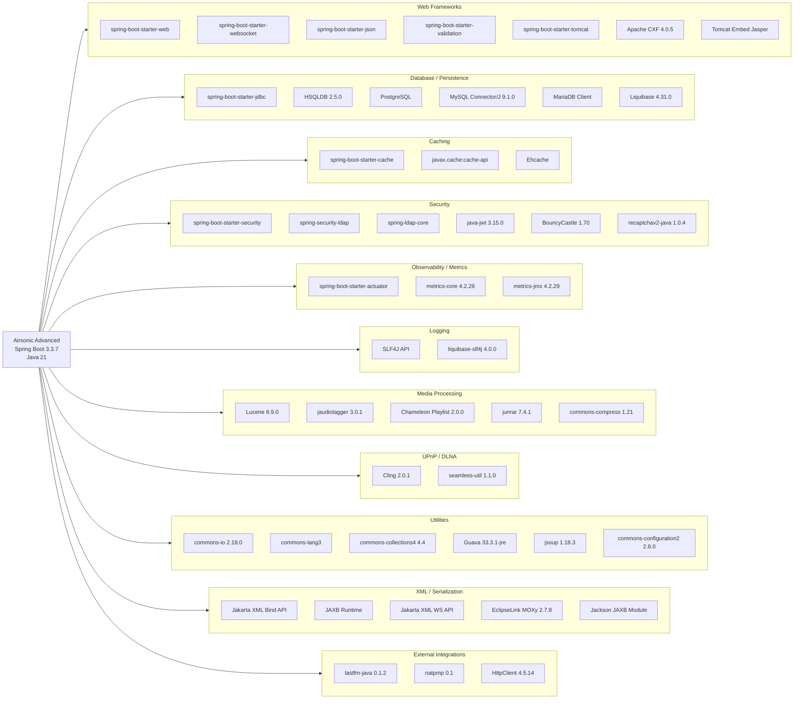
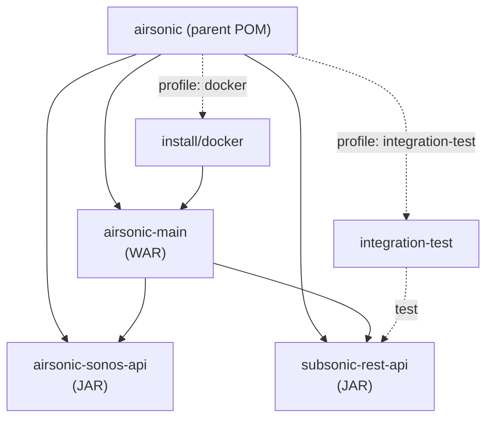

# Dependency Map - Airsonic Advanced

> Generated: 2026-07-06
> Project: org.airsonic.player:airsonic 11.0.0-SNAPSHOT
> Parent: org.springframework.boot:spring-boot-starter-parent:3.3.7
> Java Version: 21

## Dependency Architecture Diagram

## Dependency Summary

### Web Frameworks

| Name | Version | Scope | Module | Purpose |
|------|---------|-------|--------|---------|
| spring-boot-starter-web | 3.3.7 (managed) | compile | airsonic-main | Core web MVC framework with embedded Tomcat |
| spring-boot-starter-websocket | 3.3.7 (managed) | compile | airsonic-main | WebSocket support for real-time streaming updates |
| spring-boot-starter-json | 3.3.7 (managed) | compile | airsonic-main | Jackson JSON serialization/deserialization |
| spring-boot-starter-validation | 3.3.7 (managed) | compile | airsonic-main | Bean validation with Hibernate Validator |
| spring-boot-starter-tomcat | 3.3.7 (managed) | provided | airsonic-main | Embedded Tomcat servlet container |
| org.apache.tomcat.embed:tomcat-embed-jasper | 3.3.7 (managed) | provided | airsonic-main | JSP compilation support for embedded Tomcat |
| jakarta.servlet:jakarta.servlet-api | 6.0.x (managed) | provided | airsonic-main | Servlet API specification |
| jakarta.servlet.jsp:jakarta.servlet.jsp-api | 3.1.1 | provided | airsonic-main | JSP API specification |
| org.apache.cxf:cxf-core | 4.0.5 | compile | airsonic-main | Apache CXF core for SOAP/REST services |
| org.apache.cxf:cxf-rt-transports-http | 4.0.5 | compile | airsonic-main | CXF HTTP transport binding |
| org.apache.cxf:cxf-rt-frontend-jaxws | 4.0.5 | compile | airsonic-main | CXF JAX-WS frontend for Sonos SOAP API |
| org.apache.cxf:cxf-rt-bindings-soap | 4.0.5 | compile | airsonic-main | CXF SOAP binding implementation |
| org.apache.cxf:cxf-rt-databinding-jaxb | 4.0.5 | compile | airsonic-main | CXF JAXB data binding for XML serialization |
| org.glassfish.web:jakarta.servlet.jsp.jstl | 1.2.6 | runtime | airsonic-main | JSTL implementation for JSP views |
| org.apache.taglibs:taglibs-standard-impl | 1.2.5 | compile | airsonic-main | JSTL standard tag library implementation |
| taglibs:string | 1.1.0 | runtime | airsonic-main | String manipulation JSP tag library |
| net.sargue:java-time-jsptags | 1.1.4 | compile | airsonic-main | Java Time API JSP tags |

### Database / Persistence

| Name | Version | Scope | Module | Purpose |
|------|---------|-------|--------|---------|
| spring-boot-starter-jdbc | 3.3.7 (managed) | compile | airsonic-main | Spring JDBC with HikariCP connection pool |
| org.hsqldb:hsqldb | 2.5.0 | runtime | airsonic-main | Default embedded database (HyperSQL) |
| org.postgresql:postgresql | managed | runtime | airsonic-main | PostgreSQL JDBC driver |
| com.mysql:mysql-connector-j | 9.1.0 | runtime | airsonic-main | MySQL JDBC driver |
| org.mariadb.jdbc:mariadb-java-client | managed | runtime | airsonic-main | MariaDB JDBC driver |
| org.liquibase:liquibase-core | 4.31.0 | compile | airsonic-main | Database schema migration and versioning |

### Caching

| Name | Version | Scope | Module | Purpose |
|------|---------|-------|--------|---------|
| spring-boot-starter-cache | 3.3.7 (managed) | compile | airsonic-main | Spring Cache abstraction |
| javax.cache:cache-api | managed | compile | airsonic-main | JCache (JSR-107) API |
| org.ehcache:ehcache | managed | compile | airsonic-main | Ehcache 3 as JCache provider |

### Security

| Name | Version | Scope | Module | Purpose |
|------|---------|-------|--------|---------|
| spring-boot-starter-security | 3.3.7 (managed) | compile | airsonic-main | Spring Security authentication/authorization |
| spring-security-ldap | managed | compile | airsonic-main | LDAP authentication support |
| spring-security-taglibs | managed | compile | airsonic-main | Security JSP tag library (access control in views) |
| org.springframework.ldap:spring-ldap-core | managed | compile | airsonic-main | LDAP operations core library |
| com.auth0:java-jwt | 3.15.0 | compile | airsonic-main | JWT token generation and verification |
| org.bouncycastle:bcprov-jdk15on | 1.70 | runtime | airsonic-main | Cryptographic provider (password hashing, encryption) |
| de.triology.recaptchav2-java:recaptchav2-java | 1.0.4 | compile | airsonic-main | Google reCAPTCHA v2 verification |

### Observability / Metrics

| Name | Version | Scope | Module | Purpose |
|------|---------|-------|--------|---------|
| spring-boot-starter-actuator | 3.3.7 (managed) | compile | airsonic-main | Application health, metrics, and management endpoints |
| io.dropwizard.metrics:metrics-core | 4.2.29 | compile | airsonic-main | Application metrics collection framework |
| io.dropwizard.metrics:metrics-jmx | 4.2.29 | compile | airsonic-main | JMX export of metrics |

### Logging

| Name | Version | Scope | Module | Purpose |
|------|---------|-------|--------|---------|
| org.slf4j:slf4j-api | managed | compile | airsonic-main | Logging facade API |
| com.mattbertolini:liquibase-slf4j | 4.0.0 | runtime | airsonic-main | Routes Liquibase logging through SLF4J |

### Media Processing

| Name | Version | Scope | Module | Purpose |
|------|---------|-------|--------|---------|
| org.apache.lucene:lucene-core | 8.9.0 | compile | airsonic-main | Full-text search engine for music library indexing |
| org.apache.lucene:lucene-analyzers-common | 8.9.0 | compile | airsonic-main | Lucene text analyzers for search queries |
| net.jthink:jaudiotagger | 3.0.1 | compile | airsonic-main | Audio metadata (ID3 tags) reading/writing |
| com.github.muff1nman.chameleon:core | 2.0.0-RELEASE | compile | airsonic-main | Playlist file format parsing core |
| com.github.muff1nman.chameleon:playlist-xspf | 2.0.0-RELEASE | compile | airsonic-main | XSPF playlist format support |
| com.github.muff1nman.chameleon:playlist-all | 2.0.0-RELEASE | runtime | airsonic-main | All supported playlist formats (M3U, PLS, etc.) |
| org.apache.commons:commons-compress | 1.21 | compile | airsonic-main | Archive compression/decompression (ZIP, TAR, etc.) |
| org.tukaani:xz | 1.8 | compile | airsonic-main | XZ/LZMA2 compression support |
| com.github.junrar:junrar | 7.4.1 | compile | airsonic-main | RAR archive extraction |

### UPnP / DLNA

| Name | Version | Scope | Module | Purpose |
|------|---------|-------|--------|---------|
| org.fourthline.cling:cling-core | 2.0.1 | compile | airsonic-main | UPnP/DLNA protocol stack for media streaming |
| org.fourthline.cling:cling-support | 2.0.1 | compile | airsonic-main | UPnP media server/renderer support classes |
| org.seamless:seamless-util | 1.1.0 | compile | airsonic-main | Utility classes required by Cling UPnP stack |

### External Integrations

| Name | Version | Scope | Module | Purpose |
|------|---------|-------|--------|---------|
| de.u-mass:lastfm-java | 0.1.2 | compile | airsonic-main | Last.fm scrobbling and artist info API client |
| com.hoodcomputing:natpmp | 0.1 | compile | airsonic-main | NAT-PMP port mapping for network traversal |
| org.apache.httpcomponents:httpclient | 4.5.14 | compile | airsonic-main | HTTP client for external API calls |
| org.apache.httpcomponents:httpcore | managed | compile | airsonic-main | HTTP core protocol implementation |

### XML / Serialization

| Name | Version | Scope | Module | Purpose |
|------|---------|-------|--------|---------|
| jakarta.xml.bind:jakarta.xml.bind-api | managed | compile | airsonic-main, sonos-api, rest-api | JAXB XML binding API |
| org.glassfish.jaxb:jaxb-runtime | managed | compile | sonos-api, rest-api | JAXB reference implementation runtime |
| jakarta.xml.ws:jakarta.xml.ws-api | managed | compile | airsonic-main, sonos-api | JAX-WS web services API |
| jakarta.jws:jakarta.jws-api | 3.0.0 | compile | sonos-api | Java Web Services annotations |
| org.eclipse.persistence:org.eclipse.persistence.moxy | 2.7.8 | compile | airsonic-main | EclipseLink MOXy for JAXB/JSON marshalling |
| com.fasterxml.jackson.module:jackson-module-jaxb-annotations | managed | compile | airsonic-main | Jackson support for JAXB annotations |
| org.jvnet.staxex:stax-ex | 2.1.0 | compile (managed) | - | Extended StAX API (convergence fix) |

### Utilities

| Name | Version | Scope | Module | Purpose |
|------|---------|-------|--------|---------|
| commons-io:commons-io | 2.18.0 | compile | airsonic-main | File/stream I/O utility classes |
| commons-codec:commons-codec | managed | compile | airsonic-main | Encoding/decoding (Base64, Hex, URL) |
| commons-lang:commons-lang | 2.6 | compile | airsonic-main | Legacy Java language utilities |
| org.apache.commons:commons-lang3 | managed | compile | airsonic-main | Modern Java language utilities |
| org.apache.commons:commons-collections4 | 4.4 | compile | airsonic-main | Extended collection types and utilities |
| org.apache.commons:commons-text | 1.13.0 | compile (managed) | - | Text processing algorithms (convergence) |
| commons-fileupload:commons-fileupload | 1.4 | compile | airsonic-main | Multipart file upload handling |
| org.apache.commons:commons-configuration2 | 2.8.0 | compile | airsonic-main | Application configuration file parsing |
| commons-beanutils:commons-beanutils | 1.9.4 | compile | airsonic-main | JavaBean introspection utilities |
| com.google.guava:guava | 33.3.1-jre | compile | airsonic-main | Google core libraries (collections, caching, I/O) |
| org.jsoup:jsoup | 1.18.3 | compile | airsonic-main | HTML parsing and sanitization |
| org.jdom:jdom | 2.0.2 | compile | airsonic-main | XML document manipulation |
| com.google.code.findbugs:jsr305 | 3.0.2 | compile | airsonic-main | Nullability annotations (@Nullable, @Nonnull) |
| org.apache.maven:maven-artifact | 3.6.0 | compile | airsonic-main | Maven version comparison utilities |
| org.apache.ant:ant | 1.10.15 | runtime | airsonic-main | Ant runtime utilities (file patterns) |

### Jakarta EE APIs

| Name | Version | Scope | Module | Purpose |
|------|---------|-------|--------|---------|
| jakarta.validation:jakarta.validation-api | managed | compile | airsonic-main | Bean Validation API |
| jakarta.annotation:jakarta.annotation-api | managed | compile | airsonic-main | Common annotations (@PostConstruct, @Resource) |
| jakarta.mail:jakarta.mail-api | managed | compile | airsonic-main | Email API for notifications |
| com.sun.mail:jakarta.mail | 2.0.1 | runtime | airsonic-main | Jakarta Mail implementation |

### Convergence / Build Infrastructure

| Name | Version | Scope | Module | Purpose |
|------|---------|-------|--------|---------|
| org.ow2.asm:asm | 9.7.1 | compile (managed) | - | Bytecode manipulation (dependency convergence fix) |
| org.checkerframework:checker-qual | 3.37.0 | compile (managed) | - | Type annotations (convergence fix) |
| com.google.errorprone:error_prone_annotations | 2.28.0 | compile (managed) | - | Error Prone annotations (convergence fix) |

---

## Test Dependencies

The following dependencies are declared with `<scope>test</scope>` and are excluded from the main architecture diagram:

| Name | Version | Module | Purpose |
|------|---------|--------|---------|
| org.springframework.boot:spring-boot-starter-test | 3.3.7 (managed) | airsonic-main, integration-test | Spring Boot test autoconfiguration and utilities |
| junit:junit | managed | airsonic-main, integration-test | JUnit 4 test framework |
| org.junit.vintage:junit-vintage-engine | managed | airsonic-main, integration-test | JUnit 4 compatibility engine for JUnit 5 platform |
| org.springframework:spring-test | managed | airsonic-main | Spring test context framework |
| org.springframework.security:spring-security-test | managed | airsonic-main | Spring Security test support (MockMvc auth) |
| org.mockito:mockito-core | managed | airsonic-main | Mock object framework for unit testing |
| org.assertj:assertj-core | managed | airsonic-main, integration-test | Fluent assertion library |
| org.hamcrest:hamcrest-core | managed | airsonic-main | Matcher framework for test assertions |
| org.xmlunit:xmlunit-core | managed | integration-test | XML comparison and validation for tests |
| org.xmlunit:xmlunit-matchers | managed | integration-test | Hamcrest matchers for XML assertions |
| com.fasterxml.jackson.core:jackson-databind | managed | integration-test | JSON parsing in integration tests |
| ch.qos.logback:logback-classic | managed | integration-test | Logback logging for test execution |
| org.apache.commons:commons-lang3 | managed | integration-test | Lang utilities in integration tests |
| commons-codec:commons-codec | managed | integration-test | Encoding utilities in integration tests |
| commons-io:commons-io | 2.18.0 | integration-test | File I/O in integration tests |
| org.slf4j:slf4j-api | managed | integration-test | Logging facade in integration tests |
| com.google.guava:guava | 33.3.1-jre | integration-test | Utility library in integration tests |

---

## Module Dependency Structure

## Key Observations

1. **Spring Boot 3.3.7 Parent** - Manages the majority of transitive dependency versions; explicit version overrides are used for domain-specific libraries.
2. **Multi-database support** - HSQLDB (default/embedded), PostgreSQL, MySQL, and MariaDB drivers are all included at runtime scope.
3. **Legacy JSP UI** - Heavy reliance on JSP/JSTL tag libraries and Tomcat Jasper for server-side rendering.
4. **Apache CXF 4.0.5** - Used for Sonos SOAP/WSDL integration; a significant portion of the XML/serialization stack exists to support this.
5. **Media-specific libraries** - Lucene for search indexing, jaudiotagger for ID3 metadata, Chameleon for playlist formats, and Cling for UPnP/DLNA streaming.
6. **Outdated dependencies** - Several libraries are significantly outdated: commons-lang 2.6, Cling 2.0.1, Lucene 8.9.0, java-jwt 3.15.0, and BouncyCastle 1.70.
7. **No ORM** - Uses raw Spring JDBC (not JPA/Hibernate) with Liquibase for schema management.
8. **No messaging layer** - No JMS, RabbitMQ, Kafka, or event bus dependencies detected.
